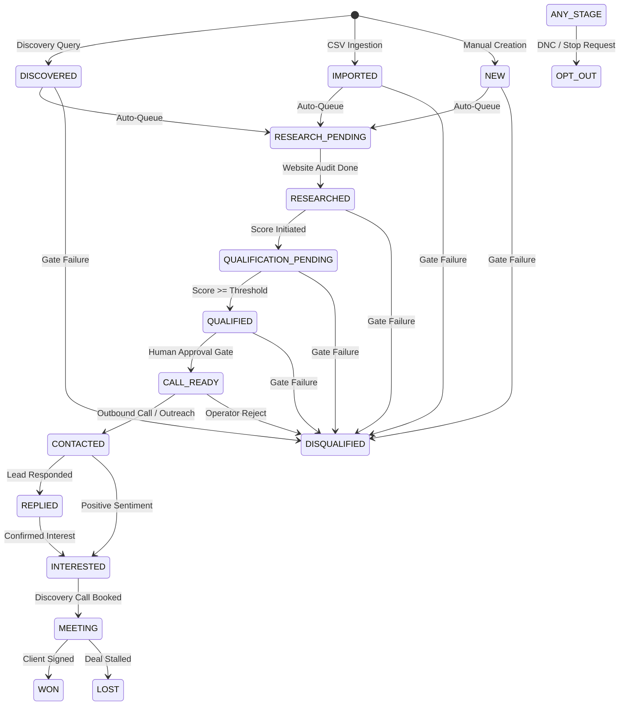

# CloseBDS / CloseVDS Master Backend API Contract Specification

**Document Version**: 2.0.0 (Production-Grade Master Contract)  
**Author / Architect**: Senior API Architect & Documentation Worker (`teamwork_worker_phase2_contracts`)  
**Target Repository**: `Dinarxn/CloseBDS-Backend` (Local: `C:\Users\Admin\Desktop\CloseBDS OS\CloseBDS Backend\backend`)  
**Frontend Reference**: `Dinarxn/CloseVDS-` (Branch: `closebds-premium-monochrome-redesign`)  
**Protocol Alignment**: RESTful JSON over HTTPS / WSS, RFC-7807 Error Envelopes, E.164 Telephony, HMAC Webhook Signatures  
**Date**: 2026-11-08  
**Status**: Authoritative Master Specification for Phase 2 Implementation  

---

## Executive Summary & Scope

This specification defines the complete, production-grade API contracts governing all communications between the CloseVDS Next.js 15 App Router frontend application, the Fastify backend engine, external telephony/voice AI carriers (Twilio, Retell AI, Vapi), third-party automation gateways (n8n), and messaging providers (Resend, Meta WhatsApp Cloud API).

Every endpoint across all 19 functional domains is specified with:
1. Exact HTTP method and URL path prefix (`/api/v1`)
2. Role-Based Access Control (RBAC) permissions (`OWNER`, `ADMIN`, `MEMBER`) and authentication requirements
3. Headers, Path Parameters, and Query String validation rules
4. JSON Schema validation rules with boundary constraints, types, and defaults
5. Concrete Success JSON response payloads (HTTP 200/201)
6. Concrete Error JSON response payloads for all status codes (HTTP 400, 401, 403, 404, 409, 422, 429, 503)
7. State transition mechanics, safety invariants, and idempotency guarantees

---

# SECTION 1: GLOBAL STANDARDS & ARCHITECTURAL CONVENTIONS

### 1.1 Base URL & Environment Addressing

All API routes are grouped under the `/api/v1` prefix.

| Environment | Base URL | Protocol | Port |
| :--- | :--- | :--- | :--- |
| **Local Development** | `http://localhost:4000/api/v1` | HTTP/1.1 | 4000 |
| **Docker Compose / CI** | `http://backend:4000/api/v1` | HTTP/1.1 | 4000 |
| **Staging Environment** | `https://staging-api.closevds.com/api/v1` | HTTPS (TLS 1.3) | 443 |
| **Production Environment** | `https://api.closevds.com/api/v1` | HTTPS (TLS 1.3) | 443 |

---

### 1.2 Dual-Layer Authentication & Session Management

The API implements a dual-layer authentication architecture designed for seamless browser interaction combined with headless API client flexibility.

```mermaid
sequenceDiagram
    autonumber
    actor Client as Next.js Client / API Consumer
    participant API as Fastify Gateway
    participant Session as Redis / Session Token
    participant DB as PostgreSQL

    Client->>API: POST /api/v1/auth/login { email, password }
    API->>DB: Query User & Workspace by Email
    API->>API: Verify Bcrypt Hash & Workspace Status
    API->>API: Generate Signed JWT Token (RS256/HS256)
    API-->>Client: HTTP 200 OK<br/>Set-Cookie: session_token=<jwt>; HttpOnly; Secure; SameSite=Lax; Path=/<br/>{ token: "<jwt>", user: {...}, workspace: {...} }
    Note over Client,API: Subsequent requests carry both cookie and Authorization header
    Client->>API: GET /api/v1/leads (with Cookie or Authorization: Bearer <jwt>)
    API->>API: Validate Token & Attach request.authenticatedUser & request.workspaceContext
    API-->>Client: HTTP 200 OK { success: true, data: [...] }
```

#### Layer A: Secure HTTP-Only Cookie (`session_token`)
- **Cookie Name**: `session_token`
- **HttpOnly**: `true` (Inaccessible to JavaScript, immune to XSS token theft)
- **SameSite**: `Lax` (Protects against CSRF while permitting top-level navigation)
- **Secure**: `true` in production (`false` in local HTTP development)
- **Path**: `/`
- **Max-Age**: `604800` seconds (7 days rolling expiration)

#### Layer B: Bearer JWT Authorization Header
- **Header**: `Authorization: Bearer <jwt_token>`
- **Token Format**: Standard RFC-7519 JSON Web Token
- **Payload Claims**:
  ```json
  {
    "userId": "usr_9b1deb4d-3b7d-4bad-9bdd-2b0d7b3dcb6d",
    "workspaceId": "ws_1a2b3c4d-5e6f-7a8b-9c0d-1e2f3a4b5c6d",
    "email": "operator@acmegrowth.com",
    "role": "OWNER",
    "iat": 1731088800,
    "exp": 1731693600
  }
  ```

#### Authentication Precedence & Expiration Mechanics
1. Fastify authentication hook checks `request.cookies.session_token`. If present, validates and sets `request.authenticatedUser`.
2. If cookie is absent, checks `request.headers.authorization` for `Bearer <token>`.
3. If both are absent or invalid on protected endpoints, returns HTTP 401 `UNAUTHORIZED`.
4. **Client-Side Session Expiry Protocol**:
   - When the frontend receives HTTP 401 on any protected endpoint (excluding `/auth/login` and `/auth/register`), the `ApiClient` removes `closevds_token` from `localStorage`, dispatches window event `closevds:session_expired`, and redirects to `/login`.

---

### 1.3 Tenant Workspace Context & Standard Request Headers

CloseBDS enforces multi-tenant isolation at the database layer. Every authenticated user belongs to an active tenant workspace.

| Header Name | Type | Required | Description | Example |
| :--- | :--- | :--- | :--- | :--- |
| `Content-Type` | String | Yes (for bodies) | Request media type | `application/json; charset=utf-8` |
| `Accept` | String | No | Accepted media type | `application/json` |
| `Authorization` | String | Conditional | Bearer JWT (if cookie absent) | `Bearer eyJhbGciOiJIUzI1Ni...` |
| `X-Workspace-Id` | UUID | Optional | Workspace override (for multi-tenant admins) | `ws_1a2b3c4d-5e6f-7a8b-9c0d-1e2f3a4b5c6d` |
| `X-Request-Id` | UUID | Recommended | Unique correlation identifier for tracing | `req_e7c3b1a2-8f9d-4c3e-bb21-123456789abc` |
| `X-Idempotency-Key` | String | Optional | Unique key for deduplicating mutations | `idemp_9918237192837192` |
| `X-N8N-API-Key` | String | Scoped | Required for `/integrations/n8n/*` endpoints | `cvds_live_ab1234567890abcdef1234567890abcdef` |

---

### 1.4 Canonical JSON Error Envelope Specification

Every error response across the entire Fastify backend strictly conforms to the canonical JSON error envelope handled by the frontend's `ApiClientError`.

#### Standard Envelope Schema
```json
{
  "error": {
    "code": "STRING_ERROR_CODE",
    "message": "Human readable description of the error condition.",
    "details": "Optional string, array, or object providing granular validation or diagnostic details.",
    "requestId": "uuid-or-correlation-id"
  }
}
```

#### Canonical Error Codes Catalog

| HTTP Status | Error Code | Description / Trigger Scenario |
| :--- | :--- | :--- |
| **400** | `VALIDATION_FAILED` | Request schema validation failed (Zod parser error). |
| **400** | `INVALID_PAYLOAD` | Malformed JSON or unparseable request body. |
| **400** | `INVALID_STAGE_TRANSITION` | Attempted lead stage transition prohibited by transition matrix. |
| **400** | `PHONE_FORMAT_INVALID` | Phone number does not conform to E.164 international standard. |
| **400** | `TIME_FORMAT_INVALID` | Calling window is not in 24-hour HH:MM format. |
| **400** | `READINESS_CHECK_FAILED` | Voice agent activation blocked due to failed readiness gates. |
| **401** | `UNAUTHORIZED` | Missing, expired, or invalid session cookie / JWT token. |
| **401** | `INVALID_CREDENTIALS` | Incorrect email or password on login. |
| **403** | `FORBIDDEN` | Authenticated user lacks required RBAC role (`OWNER`, `ADMIN`). |
| **403** | `PERMISSION_GATE_REQUIRED` | Attempted outbound call or email dispatch without prior human approval. |
| **403** | `WORKSPACE_ACCESS_DENIED` | Attempted access to a resource belonging to a different tenant. |
| **404** | `NOT_FOUND` | Requested entity does not exist in workspace. |
| **404** | `LEAD_NOT_FOUND` | Specified lead ID does not exist in active workspace. |
| **404** | `CALL_NOT_FOUND` | Specified voice call ID does not exist in active workspace. |
| **404** | `AGENT_NOT_FOUND` | Specified voice agent configuration does not exist in active workspace. |
| **409** | `CONFLICT` | Resource already exists (e.g. duplicate email, duplicate number). |
| **409** | `DUPLICATE_CALL_IN_PROGRESS`| Active call already initiated for this contact or lead. |
| **422** | `UNPROCESSABLE_ENTITY` | Semantic business rule violation despite schema compliance. |
| **429** | `RATE_LIMITED` | Request rate exceeds configured threshold. |
| **500** | `INTERNAL_ERROR` | Unhandled server exception (logged with stack trace). |
| **503** | `DATABASE_UNAVAILABLE` | PostgreSQL connection pool exhausted or database offline. |
| **503** | `KILL_SWITCH_ACTIVE` | Global or workspace calling emergency kill switch is activated. |
| **503** | `PROVIDER_UNAVAILABLE` | Upstream provider (Twilio, Retell, Vapi, Resend) offline or timing out. |

#### Concrete Error Response Examples

##### 1. HTTP 400 Validation Error (Zod Issue Details)
```json
{
  "error": {
    "code": "VALIDATION_FAILED",
    "message": "Validation failed: businessName: Required; phone: Phone number must start with international country code (e.g. +15125550199)",
    "details": [
      {
        "code": "invalid_type",
        "expected": "string",
        "received": "undefined",
        "path": ["businessName"],
        "message": "Required"
      },
      {
        "code": "custom",
        "path": ["phone"],
        "message": "Phone number must start with international country code (e.g. +15125550199)"
      }
    ],
    "requestId": "req_8f12a34b-c123-4567-89ab-cdef01234567"
  }
}
```

##### 2. HTTP 401 Unauthorized Error
```json
{
  "error": {
    "code": "UNAUTHORIZED",
    "message": "Session expired or authentication token invalid. Please log in again.",
    "requestId": "req_11223344-5566-7788-99aa-bbccddeeff00"
  }
}
```

##### 3. HTTP 403 Permission Gate Required (Zero-Bypass Human Gate)
```json
{
  "error": {
    "code": "PERMISSION_GATE_REQUIRED",
    "message": "Human operator sign-off is strictly required before outbound dispatch can proceed. Call status must be APPROVED.",
    "details": {
      "callId": "call_65fe7c1f-58a4-4b79-83d1-e7f20ddf7ece",
      "currentStatus": "APPROVAL_REQUIRED",
      "requiredApprovalAction": "POST /api/v1/voice/calls/call_65fe7c1f-58a4-4b79-83d1-e7f20ddf7ece/approve"
    },
    "requestId": "req_778899aa-bbcc-ddee-ff00-112233445566"
  }
}
```

##### 4. HTTP 404 Entity Not Found
```json
{
  "error": {
    "code": "LEAD_NOT_FOUND",
    "message": "Lead with ID 'lead_e8a12345-6789-abcd-ef01-23456789abcd' was not found in active workspace.",
    "requestId": "req_33445566-7788-99aa-bbcc-ddeeff001122"
  }
}
```

##### 5. HTTP 409 Resource Conflict (Lead Deduplication Match)
```json
{
  "error": {
    "code": "CONFLICT",
    "message": "A lead matching business name 'Apex Dental Care' and phone '+15125550199' already exists in this workspace.",
    "details": {
      "existingLeadId": "lead_99887766-5544-3322-1100-ffeeddccbbaa",
      "matchKey": "apex dental care|+15125550199"
    },
    "requestId": "req_55667788-99aa-bbcc-ddee-ff0011223344"
  }
}
```

##### 6. HTTP 429 Rate Limit Exceeded
```json
{
  "error": {
    "code": "RATE_LIMITED",
    "message": "Too many requests. You have exceeded your rate limit of 100 requests per minute.",
    "details": {
      "retryAfterSeconds": 42
    },
    "requestId": "req_aa11bb22-cc33-dd44-ee55-ff66aa77bb88"
  }
}
```

##### 7. HTTP 503 Kill Switch Active
```json
{
  "error": {
    "code": "KILL_SWITCH_ACTIVE",
    "message": "Outbound outreach is currently suspended by emergency kill switch.",
    "details": {
      "scope": "workspace",
      "activatedAt": "2026-11-08T18:00:00.000Z",
      "reason": "Emergency maintenance and telephony trunk verification"
    },
    "requestId": "req_eeff0011-2233-4455-6677-8899aabbccdd"
  }
}
```

---

### 1.5 Standard Pagination, Filtering & Sorting Conventions

All collection listing endpoints adopt uniform pagination, filtering, and ordering semantics.

#### Standard Query Parameters
| Parameter | Type | Required | Default | Description |
| :--- | :--- | :--- | :--- | :--- |
| `page` | Integer | No | `1` | 1-based page offset index (min: 1) |
| `limit` | Integer | No | `20` | Number of items per page (min: 1, max: 100) |
| `search` | String | No | `""` | Case-insensitive full-text search term |
| `status` | String | No | `undefined` | Domain-specific status filter enum |
| `campaignId` | UUID | No | `undefined` | Scopes results to a single marketing campaign |
| `from` | ISO 8601 | No | `undefined` | Filter records created/updated after timestamp |
| `to` | ISO 8601 | No | `undefined` | Filter records created/updated before timestamp |
| `sortBy` | String | No | `"createdAt"` | Attribute field name to order by |
| `sortOrder` | Enum | No | `"desc"` | Sort direction: `"asc"` or `"desc"` |

#### Standard Paginated Collection Response Format
```json
{
  "success": true,
  "data": [ /* Array of entity records */ ],
  "total": 142,
  "page": 1,
  "limit": 20,
  "totalPages": 8
}
```

---

### 1.6 Idempotency Engine & Deduplication Rules

Mutating operations (call staging, campaign creation, lead batch import, webhook processing) support idempotency via the `X-Idempotency-Key` header or request body `idempotencyKey`.

1. **Storage & Verification**: When an idempotent request arrives, Fastify computes a SHA-256 hash of `(workspaceId + idempotencyKey)`.
2. **In-Flight Lock**: If a request with the same key is currently processing, subsequent requests receive HTTP 409 with code `CONCURRENT_REQUEST`.
3. **Replay Cache**: Completed requests store their HTTP status code and response payload in the database/Redis with a 24-hour TTL. Identical replayed requests return the cached response verbatim, preventing duplicate records or duplicate phone calls.

---

### 1.7 Rate Limiting & Throttling Standards

Rate limiting is enforced at the Fastify gateway via `@fastify/rate-limit`.

| Tier | Endpoints | Limit | Window | Key Identifier |
| :--- | :--- | :--- | :--- | :--- |
| **Authentication** | `POST /auth/login`, `POST /auth/register` | 20 req | 1 minute | Client IP address |
| **Password Reset** | `POST /auth/forgot-password` | 5 req | 1 hour | Client IP + Email |
| **General API** | `/leads/*`, `/crm/*`, `/voice/*`, `/analytics/*` | 100 req | 1 minute | User ID or Client IP |
| **n8n Automation** | `/integrations/n8n/*` | 300 req | 1 minute | `X-N8N-API-Key` prefix |
| **Webhooks Ingress** | `/voice/webhooks/*`, `/integrations/webhooks/*` | 600 req | 1 minute | Provider Client IP |

#### Rate Limit Response Headers
- `X-RateLimit-Limit`: Maximum requests permitted in window.
- `X-RateLimit-Remaining`: Remaining request allowance.
- `X-RateLimit-Reset`: UNIX epoch seconds when current window resets.

---

### 1.8 Credential Security & Masking Invariants

1. **AES-256-GCM Encryption at Rest**: All third-party secrets (Twilio Account SID, Twilio Auth Token, Retell API Key, Retell Webhook Secret, Vapi API Key, Resend API Key) are encrypted at rest using AES-256-GCM with a PBKDF2-derived master secret key and unique 12-byte initialization vectors (IV).
2. **Zero Plaintext Secret Leakage**: No API response ever returns raw credential tokens. Responses return masked tokens:
   - Account SID: `AC•••••••••••••••••••••••••••••9876` (first 2 chars + dots + last 4 chars)
   - API Key / Auth Token: `••••••••••••••••4321` (all dots + last 4 chars)
3. **Zero Test Dispatch Invariant**: The backend must never purchase live carrier lines or dispatch real chargeable telephone calls during test runs or development. Carrier adapters evaluate full cryptographic signatures and simulate media streaming without incurring charges.

---

# SECTION 2: CANONICAL STATE MACHINES & TRANSITION MATRICES

### 2.1 Lead Canonical Status Enum & Allowed Transition Matrix

The CloseBDS Acquisition OS defines exactly 16 canonical lead stages with strict forward progression and disqualification/opt-out escape paths.



#### Complete 16-State Allowed Transition Table
```typescript
export const ALLOWED_STAGE_TRANSITIONS: Record<CanonicalLeadStatus, CanonicalLeadStatus[]> = {
  DISCOVERED:             ['IMPORTED', 'RESEARCH_PENDING', 'DISQUALIFIED', 'OPT_OUT'],
  IMPORTED:               ['RESEARCH_PENDING', 'RESEARCHED', 'DISQUALIFIED', 'OPT_OUT'],
  NEW:                    ['DISCOVERED', 'IMPORTED', 'RESEARCH_PENDING', 'QUALIFIED', 'DISQUALIFIED', 'CONTACTED', 'OPT_OUT'],
  RESEARCH_PENDING:       ['RESEARCHED', 'QUALIFICATION_PENDING', 'DISQUALIFIED', 'OPT_OUT'],
  RESEARCHED:             ['QUALIFICATION_PENDING', 'QUALIFIED', 'DISQUALIFIED', 'OPT_OUT'],
  QUALIFICATION_PENDING:  ['QUALIFIED', 'DISQUALIFIED', 'CALL_READY', 'OPT_OUT'],
  QUALIFIED:              ['CALL_READY', 'CONTACTED', 'DISQUALIFIED', 'OPT_OUT'],
  DISQUALIFIED:           ['QUALIFIED', 'RESEARCH_PENDING', 'OPT_OUT'],
  CALL_READY:             ['CONTACTED', 'QUALIFIED', 'DISQUALIFIED', 'OPT_OUT'],
  CONTACTED:              ['INTERESTED', 'REPLIED', 'MEETING', 'LOST', 'QUALIFIED', 'DISQUALIFIED', 'OPT_OUT'],
  REPLIED:                ['INTERESTED', 'MEETING', 'LOST', 'QUALIFIED', 'DISQUALIFIED', 'OPT_OUT', 'CONTACTED'],
  INTERESTED:             ['MEETING', 'WON', 'LOST', 'DISQUALIFIED', 'OPT_OUT'],
  MEETING:                ['WON', 'LOST', 'INTERESTED', 'DISQUALIFIED', 'OPT_OUT'],
  WON:                    ['LOST', 'OPT_OUT'],
  LOST:                   ['INTERESTED', 'QUALIFIED', 'DISQUALIFIED', 'OPT_OUT'],
  OPT_OUT:                [], // Terminal state. Zero transitions permitted.
};
```

---

### 2.2 Voice Call Lifecycle State Machine (15 States)

Every outbound phone call advances through 15 tightly managed lifecycle states enforcing human approval gates and safety pre-flight verification.

| State | Category | Description | Next Permitted States |
| :--- | :--- | :--- | :--- |
| `QUEUED` | Staging | Call context synthesized and placed in dialing queue. | `SAFETY_CHECKING`, `CANCELLED` |
| `SAFETY_CHECKING` | Safety | 18 pre-flight gates actively evaluating in real-time. | `APPROVAL_REQUIRED`, `BLOCKED`, `CANCELLED` |
| `APPROVAL_REQUIRED` | Safety | Gate passed; waiting for human operator sign-off. | `APPROVED`, `BLOCKED`, `CANCELLED` |
| `APPROVED` | Safety | Human operator authorized call dispatch. | `INITIATING`, `CANCELLED` |
| `INITIATING` | Carrier | Call payload dispatched to Twilio/Retell trunk. | `RINGING`, `FAILED`, `CANCELLED` |
| `RINGING` | Carrier | Carrier trunk signaling destination phone. | `IN_PROGRESS`, `NO_ANSWER`, `BUSY`, `VOICEMAIL`, `FAILED` |
| `IN_PROGRESS` | Active | Media stream established; dual-speaker dialogue active. | `COMPLETED`, `FAILED`, `OPTED_OUT` |
| `COMPLETED` | Concluded | Call ended naturally; AI outcome analysis generated. | Terminal state |
| `BLOCKED` | Suppressed | Blocked by safety engine (DNC, timezone, quota, operator). | Terminal state |
| `FAILED` | Error | Carrier network error, SIP failure, or provider timeout. | Terminal state |
| `CANCELLED` | Manual | Operator cancelled staged call prior to connection. | Terminal state |
| `NO_ANSWER` | Disposition | Recipient phone rang out without answer. | Terminal state |
| `BUSY` | Disposition | Destination carrier returned 486 Busy Here. | Terminal state |
| `VOICEMAIL` | Disposition | Answering machine detection (AMD) tripped. | Terminal state |
| `OPTED_OUT` | Compliance | Verbal opt-out detected during call; lead suppressed. | Terminal state |

---

### 2.3 11-Step Voice Agent Studio State Machine

Voice agents configured through the 11-step wizard progress through an audited readiness lifecycle before handling live outbound or inbound calls.

| Status | Description | Allowed Operations |
| :--- | :--- | :--- |
| `DRAFT` | Initial configuration created; steps 1–3 defined. | Edit, Delete |
| `INCOMPLETE` | Prompt, knowledge, or phone line missing. | Edit, Delete |
| `READY_FOR_TEST` | Steps 1–9 configured; ready for diagnostic test call. | Edit, Test Call, Delete |
| `TESTED` | Diagnostic test call completed with logs recorded. | Edit, Activate, Re-test |
| `ACTIVE` | Pre-activation readiness report passed; handling calls. | Pause, Edit (hot-reload) |
| `PAUSED` | Operator manually paused active agent. | Activate, Edit, Delete |
| `ERROR` | Underlying carrier line disconnected or provider auth failed. | Edit, Re-test, Delete |

---

### 2.4 Multi-Channel Outreach State Machine

Outreach drafts (cold emails, WhatsApp messages) enforce human approval prior to transmission.

- `DRAFT`: Initial personalized copy generated by LangGraph / AI. `isApproved: false`.
- `APPROVED`: Human operator reviewed and authorized message transmission. `isApproved: true`.
- `INITIATING`: Message sent to Resend / Meta WhatsApp Cloud API.
- `SENT`: Provider acknowledged receipt and queued for final mailbox delivery.
- `REJECTED`: Human reviewer rejected draft with reason notes.
- `CANCELLED`: Operator cancelled staged message before transmission.
- `FAILED`: Provider returned delivery failure or bounce.

---

# SECTION 3: MODULE-BY-MODULE API CONTRACTS

---

## MODULE 1: AUTHENTICATION & SESSION MANAGEMENT (`/auth/*`)

Provides user registration, password authentication, session management, and self-service password recovery.

### 1.1 User Registration
- **Description**: Creates a new operator user account and provisions their initial tenant workspace.
- **Method & Path**: `POST /api/v1/auth/register`
- **Auth / RBAC**: Public (Unauthenticated).
- **Rate Limit**: 20 requests per minute per IP.
- **Headers**: `Content-Type: application/json`
- **Request Body Schema**:
  ```typescript
  {
    name: string;          // min: 2, max: 100
    email: string;         // valid email format, max: 255
    password: string;      // min: 8, max: 128, must contain upper, lower, number
    workspaceName?: string // optional tenant name, min: 2, max: 100
  }
  ```
- **Success Response (HTTP 201 Created)**:
  - Sets HttpOnly Cookie: `session_token=<jwt>; Path=/; SameSite=Lax; Max-Age=604800`
  ```json
  {
    "success": true,
    "user": {
      "id": "usr_9b1deb4d-3b7d-4bad-9bdd-2b0d7b3dcb6d",
      "workspaceId": "ws_1a2b3c4d-5e6f-7a8b-9c0d-1e2f3a4b5c6d",
      "email": "sarah.connor@acmegrowth.com",
      "name": "Sarah Connor",
      "role": "OWNER",
      "isActive": true,
      "createdAt": "2026-11-08T18:00:00.000Z"
    },
    "token": "eyJhbGciOiJIUzI1NiIsInR5cCI6IkpXVCJ9.eyJ1c2VySWQiOiJ1c3JfOWIxZGViNGQtM2I3ZC00YmFkLTliZGQtMmIwZDdiM2RjYjZkIiwid29ya3NwYWNlSWQiOiJ3c18xYTJiM2M0ZC01ZTZmLTdhOGItOWMwZC0xZTJmM2E0YjVjNmQiLCJyb2xlIjoiT1dORVIiLCJpYXQiOjE3MzEwODg4MDB9.abcdef",
    "workspace": {
      "id": "ws_1a2b3c4d-5e6f-7a8b-9c0d-1e2f3a4b5c6d",
      "name": "Acme Growth Lab",
      "slug": "acme-growth-lab"
    }
  }
  ```
- **Error Responses**:
  - `HTTP 400 VALIDATION_FAILED`: Password does not meet complexity standards.
    ```json
    {
      "error": {
        "code": "VALIDATION_FAILED",
        "message": "Validation failed: password: Password must be at least 8 characters long and contain uppercase, lowercase, and numeric characters.",
        "requestId": "req_reg_400"
      }
    }
    ```
  - `HTTP 409 CONFLICT`: Email address already registered.
    ```json
    {
      "error": {
        "code": "CONFLICT",
        "message": "An account with email 'sarah.connor@acmegrowth.com' already exists.",
        "requestId": "req_reg_409"
      }
    }
    ```
  - `HTTP 429 RATE_LIMITED`: Exceeded 20 registrations/minute.

---

### 1.2 User Login
- **Description**: Authenticates operator with email and password, establishing an authenticated session.
- **Method & Path**: `POST /api/v1/auth/login`
- **Auth / RBAC**: Public (Unauthenticated).
- **Rate Limit**: 20 requests per minute per IP.
- **Request Body**:
  ```json
  {
    "email": "sarah.connor@acmegrowth.com",
    "password": "Password123!"
  }
  ```
- **Success Response (HTTP 200 OK)**:
  - Sets HttpOnly Cookie: `session_token=<jwt>`
  ```json
  {
    "success": true,
    "user": {
      "id": "usr_9b1deb4d-3b7d-4bad-9bdd-2b0d7b3dcb6d",
      "workspaceId": "ws_1a2b3c4d-5e6f-7a8b-9c0d-1e2f3a4b5c6d",
      "email": "sarah.connor@acmegrowth.com",
      "name": "Sarah Connor",
      "role": "OWNER",
      "isActive": true,
      "createdAt": "2026-11-08T18:00:00.000Z"
    },
    "token": "eyJhbGciOiJIUzI1NiIsInR5cCI6IkpXVCJ9...",
    "workspace": {
      "id": "ws_1a2b3c4d-5e6f-7a8b-9c0d-1e2f3a4b5c6d",
      "name": "Acme Growth Lab",
      "slug": "acme-growth-lab"
    }
  }
  ```
- **Error Responses**:
  - `HTTP 401 INVALID_CREDENTIALS`:
    ```json
    {
      "error": {
        "code": "INVALID_CREDENTIALS",
        "message": "Invalid email or password combination.",
        "requestId": "req_login_401"
      }
    }
    ```

---

### 1.3 User Logout
- **Description**: Destroys session cookie and clears client authorization tokens.
- **Method & Path**: `POST /api/v1/auth/logout`
- **Auth / RBAC**: Authenticated (Graceful on invalid tokens).
- **Success Response (HTTP 200 OK)**:
  - Clears Cookie: `session_token=; Max-Age=0; Path=/`
  ```json
  {
    "success": true,
    "message": "Logged out successfully"
  }
  ```

---

### 1.4 Current User & Session Profile (`/auth/me`)
- **Description**: Validates session cookie or Bearer token, returning the current operator profile and workspace.
- **Method & Path**: `GET /api/v1/auth/me`
- **Auth / RBAC**: Authenticated (Token or Cookie required).
- **Success Response (HTTP 200 OK)**:
  ```json
  {
    "success": true,
    "user": {
      "id": "usr_9b1deb4d-3b7d-4bad-9bdd-2b0d7b3dcb6d",
      "workspaceId": "ws_1a2b3c4d-5e6f-7a8b-9c0d-1e2f3a4b5c6d",
      "email": "sarah.connor@acmegrowth.com",
      "name": "Sarah Connor",
      "role": "OWNER",
      "isActive": true,
      "createdAt": "2026-11-08T18:00:00.000Z"
    },
    "workspace": {
      "id": "ws_1a2b3c4d-5e6f-7a8b-9c0d-1e2f3a4b5c6d",
      "name": "Acme Growth Lab",
      "slug": "acme-growth-lab"
    }
  }
  ```
- **Error Responses**:
  - `HTTP 401 UNAUTHORIZED`: Session expired or invalid. Client clears token and redirects to `/login`.

---

### 1.5 Request Password Recovery
- **Description**: Issues a secure, time-limited password recovery token sent to the operator's email address.
- **Method & Path**: `POST /api/v1/auth/forgot-password`
- **Auth / RBAC**: Public (Unauthenticated).
- **Rate Limit**: 5 requests per hour per email.
- **Request Body**:
  ```json
  {
    "email": "sarah.connor@acmegrowth.com"
  }
  ```
- **Success Response (HTTP 200 OK)**:
  ```json
  {
    "success": true,
    "message": "If an account exists for this email, password reset instructions have been dispatched."
  }
  ```

---

### 1.6 Reset Password Execution
- **Description**: Validates reset token and applies new password with bcrypt hashing.
- **Method & Path**: `POST /api/v1/auth/reset-password`
- **Auth / RBAC**: Public (Token verified).
- **Request Body**:
  ```json
  {
    "token": "tok_reset_abc1234567890def",
    "password": "NewStrongPassword123!"
  }
  ```
- **Success Response (HTTP 200 OK)**:
  ```json
  {
    "success": true,
    "message": "Password reset successful. You may now log in with your new credentials."
  }
  ```
- **Error Responses**:
  - `HTTP 400 INVALID_TOKEN`: Token expired, tampered with, or previously consumed.

---

## MODULE 2: WORKSPACE & MEMBERS (`/workspaces/*`)

Provides tenant workspace configuration, settings metadata, and team member management.

### 2.1 Current Workspace Metadata
- **Method & Path**: `GET /api/v1/workspaces/current`
- **Auth / RBAC**: Authenticated (`OWNER`, `ADMIN`, `MEMBER`).
- **Success Response (HTTP 200 OK)**:
  ```json
  {
    "success": true,
    "workspace": {
      "id": "ws_1a2b3c4d-5e6f-7a8b-9c0d-1e2f3a4b5c6d",
      "name": "Acme Growth Lab",
      "slug": "acme-growth-lab",
      "createdAt": "2026-11-08T18:00:00.000Z",
      "updatedAt": "2026-11-08T18:00:00.000Z"
    }
  }
  ```

---

### 2.2 Workspace Members List
- **Method & Path**: `GET /api/v1/workspaces/current/members`
- **Auth / RBAC**: Authenticated (`OWNER`, `ADMIN`, `MEMBER`).
- **Success Response (HTTP 200 OK)**:
  ```json
  {
    "success": true,
    "members": [
      {
        "id": "usr_9b1deb4d-3b7d-4bad-9bdd-2b0d7b3dcb6d",
        "name": "Sarah Connor",
        "email": "sarah.connor@acmegrowth.com",
        "role": "OWNER",
        "isActive": true,
        "createdAt": "2026-11-08T18:00:00.000Z"
      },
      {
        "id": "usr_22334455-6677-8899-aabb-ccddeeff0011",
        "name": "Alex Vance",
        "email": "alex.vance@acmegrowth.com",
        "role": "MEMBER",
        "isActive": true,
        "createdAt": "2026-11-08T19:00:00.000Z"
      }
    ]
  }
  ```

---

## MODULE 3: DASHBOARD & PULSE TELEMETRY

Aggregates operational pipeline health, acquisition conversion metrics, and telephony provider states for the main application dashboard.

### 3.1 Pipeline KPI Pulse Overview
- **Method & Path**: `GET /api/v1/analytics/overview`
- **Auth / RBAC**: Authenticated (`OWNER`, `ADMIN`, `MEMBER`).
- **Query Parameters**: `from?` (ISO 8601), `to?` (ISO 8601), `campaignId?` (UUID)
- **Success Response (HTTP 200 OK)**:
  ```json
  {
    "success": true,
    "metrics": {
      "leads": {
        "total": 142,
        "byStatus": {
          "NEW": 24,
          "QUALIFIED": 38,
          "CALL_READY": 31,
          "CONTACTED": 22,
          "REPLIED": 12,
          "INTERESTED": 8,
          "MEETING": 5,
          "WON": 2
        },
        "qualificationRate": 78.4,
        "replyRate": 26.3
      },
      "campaigns": {
        "total": 3,
        "byStatus": {
          "ACTIVE": 2,
          "PAUSED": 1
        }
      },
      "outreach": {
        "total": 68,
        "draft": 12,
        "approved": 8,
        "sent": 42,
        "rejected": 4,
        "failed": 2,
        "approvalRate": 91.3
      },
      "crm": {
        "totalActivities": 184,
        "byType": {
          "NOTE": 64,
          "CALL_LOG": 78,
          "STAGE_CHANGE": 42
        }
      },
      "tasks": {
        "total": 18,
        "pending": 9,
        "inProgress": 4,
        "completed": 5,
        "cancelled": 0
      }
    }
  }
  ```

---

### 3.2 Provider Integration Health Status
- **Method & Path**: `GET /api/v1/settings/providers`
- **Auth / RBAC**: Authenticated (`OWNER`, `ADMIN`, `MEMBER`).
- **Success Response (HTTP 200 OK)** (Zero secrets leaked):
  ```json
  {
    "success": true,
    "providers": [
      {
        "provider": "twilio",
        "category": "CALLING",
        "isConfigured": true,
        "status": "CONFIGURED",
        "features": ["pstn_outbound", "inbound_sip", "e164_lookup"]
      },
      {
        "provider": "retell",
        "category": "CALLING",
        "isConfigured": true,
        "status": "CONFIGURED",
        "features": ["speech_to_speech", "turn_taking", "latency_optimization"]
      },
      {
        "provider": "vapi",
        "category": "CALLING",
        "isConfigured": false,
        "status": "NOT_CONFIGURED",
        "features": ["multi_model_orchestration", "tool_calling"]
      }
    ]
  }
  ```

---

## MODULE 4: OPERATIONS & TASK QUEUES (`/operations/*`)

Provides real-time telemetry, categorized operator task queues, call-ready prospect management, and dialer queue reordering.

### 4.1 Real-Time Operations Summary
- **Method & Path**: `GET /api/v1/operations/summary`
- **Auth / RBAC**: Authenticated (`OWNER`, `ADMIN`, `MEMBER`).
- **Success Response (HTTP 200 OK)**:
  ```json
  {
    "success": true,
    "data": {
      "totalOperations": 24,
      "criticalCount": 3,
      "highCount": 7,
      "mediumCount": 10,
      "routineCount": 4,
      "approvalsCount": 6,
      "callReadyCount": 15,
      "needsResearchCount": 8,
      "needsQualificationCount": 4,
      "followUpsDueCount": 6,
      "telephonyStatus": "CONNECTED",
      "voiceAiStatus": "CONNECTED",
      "closebdsStatus": "CONNECTED",
      "leadPool": {
        "total": 142,
        "discovered": 28,
        "imported": 45,
        "researchPending": 12,
        "researched": 57,
        "qualificationPending": 8,
        "qualified": 49
      },
      "voicePipeline": {
        "callReady": 15,
        "approvalRequired": 6,
        "approved": 5,
        "queued": 8,
        "inProgress": 1,
        "completedToday": 14,
        "blocked": 0
      },
      "conversions": {
        "interested": 12,
        "meetings": 5,
        "won": 2
      },
      "systemHealth": {
        "callingPolicyActive": true,
        "dailyLimit": 50,
        "callsToday": 14,
        "telephonyConfigured": true,
        "voiceAiConfigured": true,
        "agentConfigsCount": 3
      }
    }
  }
  ```

---

### 4.2 List Categorized Operational Tasks
- **Method & Path**: `GET /api/v1/operations/tasks` (Aliases: `/operations`, `/operations/approvals`, `/operations/call-ready`, `/operations/research`, `/operations/qualification`, `/operations/follow-ups`)
- **Query Parameters**:
  - `category?`: `'approvals' | 'calling' | 'research' | 'qualification' | 'followup'`
  - `priority?`: `'CRITICAL' | 'HIGH' | 'MEDIUM' | 'ROUTINE'`
- **Success Response (HTTP 200 OK)**:
  ```json
  {
    "success": true,
    "data": [
      {
        "id": "task_call_appr_123",
        "category": "approvals",
        "title": "Outbound Call Approval: Austin Dental Spa",
        "target": "Austin Dental Spa",
        "reason": "Passed pre-flight gates; awaiting operator sign-off",
        "priority": "HIGH",
        "timestamp": "2026-11-08T18:30:00.000Z",
        "actionText": "Review & Approve",
        "actionHref": "/calling/calls/call_99887766-5544-3322-1100-ffeeddccbbaa",
        "targetId": "call_99887766-5544-3322-1100-ffeeddccbbaa",
        "targetType": "call"
      }
    ]
  }
  ```

---

### 4.3 Approve Operational Task
- **Method & Path**: `POST /api/v1/operations/tasks/:taskId/approve`
- **Auth / RBAC**: Authenticated (`OWNER`, `ADMIN`, `MEMBER`).
- **Success Response (HTTP 200 OK)**:
  ```json
  {
    "success": true,
    "data": {
      "taskId": "task_call_appr_123",
      "status": "APPROVED",
      "authorizedBy": "Sarah Connor",
      "authorizedAt": "2026-11-08T18:45:00.000Z"
    },
    "message": "Task authorized successfully"
  }
  ```

---

### 4.4 Reject Operational Task
- **Method & Path**: `POST /api/v1/operations/tasks/:taskId/reject`
- **Request Body**:
  ```json
  {
    "reason": "Business phone number verified inactive"
  }
  ```
- **Success Response (HTTP 200 OK)**:
  ```json
  {
    "success": true,
    "data": {
      "taskId": "task_call_appr_123",
      "status": "REJECTED",
      "reason": "Business phone number verified inactive"
    },
    "message": "Task rejected"
  }
  ```

---

### 4.5 Active Outbound Call Queue
- **Method & Path**: `GET /api/v1/operations/queue`
- **Success Response (HTTP 200 OK)**:
  ```json
  {
    "success": true,
    "data": [
      {
        "id": "qitem_112233",
        "callId": "call_99887766-5544-3322-1100-ffeeddccbbaa",
        "leadId": "lead_1a2b3c4d",
        "businessName": "Austin Dental Spa",
        "recipientPhone": "+15125550199",
        "status": "QUEUED",
        "isApproved": true,
        "priority": 1,
        "createdAt": "2026-11-08T18:30:00.000Z"
      }
    ]
  }
  ```

---

### 4.6 Reprioritize Call Queue Item
- **Method & Path**: `POST /api/v1/operations/queue/:itemId/prioritize`
- **Request Body**:
  ```json
  {
    "priority": 10
  }
  ```
- **Success Response (HTTP 200 OK)**:
  ```json
  {
    "success": true,
    "data": {
      "itemId": "qitem_112233",
      "newPriority": 10
    },
    "message": "Queue item prioritized"
  }
  ```

---

### 4.7 Cancel Queued Call
- **Method & Path**: `POST /api/v1/operations/queue/:itemId/cancel`
- **Request Body**: `{ "reason": "Operator manually removed from queue" }`
- **Success Response (HTTP 200 OK)**:
  ```json
  {
    "success": true,
    "data": {
      "itemId": "qitem_112233",
      "status": "CANCELLED"
    },
    "message": "Call cancelled from queue"
  }
  ```

---

## MODULE 5: LEADS & CONTACTS MANAGEMENT (`/leads/*`)

Provides complete prospect CRUD, contact relationship management, AI research triggering, and operator qualification sign-off.

### 5.1 List Leads with Filters & Kanban Stages
- **Method & Path**: `GET /api/v1/leads`
- **Auth / RBAC**: Authenticated (`OWNER`, `ADMIN`, `MEMBER`).
- **Query Parameters**:
  - `page`: Integer (default 1)
  - `limit`: Integer (default 20, max 100)
  - `search`: String (searches `businessName`, `domain`, `phone`, `address`)
  - `status`: Canonical status enum (`NEW`, `QUALIFIED`, `CALL_READY`, `DISQUALIFIED`, `CONTACTED`, `REPLIED`, `OPT_OUT`, etc.)
  - `campaignId`: UUID
- **Success Response (HTTP 200 OK)**:
  ```json
  {
    "success": true,
    "data": [
      {
        "id": "lead_7f9a1b2c-3d4e-5f6a-7b8c-9d0e1f2a3b4c",
        "workspaceId": "ws_1a2b3c4d-5e6f-7a8b-9c0d-1e2f3a4b5c6d",
        "campaignId": "cmp_8e123456-789a-bcde-f012-3456789abcde",
        "businessName": "Acme Dental Care",
        "domain": "acmedentalcare.com",
        "phone": "+15125550199",
        "address": "124 Market St, Suite 400, Austin, TX 78701",
        "status": "QUALIFIED",
        "source": "google_maps",
        "dataQuality": "COMPLETE",
        "mapsUrl": "https://maps.google.com/?cid=1234567890",
        "rating": 4.8,
        "userRatingsTotal": 142,
        "createdAt": "2026-11-08T18:00:00.000Z",
        "updatedAt": "2026-11-08T18:30:00.000Z",
        "contacts": [
          {
            "id": "cnt_11223344-5566-7788-99aa-bbccddeeff00",
            "leadId": "lead_7f9a1b2c-3d4e-5f6a-7b8c-9d0e1f2a3b4c",
            "fullName": "Dr. Sarah Connor",
            "email": "sarah@acmedentalcare.com",
            "phone": "+15125550199",
            "title": "Lead Dentist & Owner",
            "isPrimary": true
          }
        ],
        "leadScore": {
          "id": "scr_998877-6655-4433",
          "relevanceScore": 88,
          "opportunityScore": 92,
          "totalScore": 90,
          "isQualified": true,
          "reasoningRationale": "High patient review volume; clinic lacks automated booking CTA on mobile site."
        },
        "websiteAudit": {
          "id": "aud_556677-8899-0011",
          "domain": "acmedentalcare.com",
          "isReachable": true,
          "mobileOptimized": true,
          "bookingCtaVisible": false,
          "summary": "Website loads in 1.4s, but mobile patient intake requires direct phone call during business hours."
        },
        "serviceRecommendation": {
          "hasOpportunity": true,
          "serviceOpportunity": "YES",
          "recommendedService": "AI Voice Receptionist",
          "reason": "Overwhelming call volume during peak surgical hours causes missed appointments.",
          "evidence": "Observed 3 Google reviews mentioning difficulty reaching clinic receptionist on weekends."
        }
      }
    ],
    "total": 45,
    "page": 1,
    "limit": 20,
    "totalPages": 3
  }
  ```

---

### 5.2 Get Lead Forensic Profile
- **Method & Path**: `GET /api/v1/leads/:id`
- **Auth / RBAC**: Authenticated (`OWNER`, `ADMIN`, `MEMBER`).
- **Success Response (HTTP 200 OK)**:
  ```json
  {
    "success": true,
    "lead": { /* Same schema as single item above with full relation graphs */ },
    "serviceRecommendation": {
      "hasOpportunity": true,
      "serviceOpportunity": "YES",
      "recommendedService": "AI Voice Receptionist",
      "reason": "Overwhelming call volume during peak surgical hours causes missed appointments."
    }
  }
  ```
- **Error Responses**:
  - `HTTP 404 LEAD_NOT_FOUND`: Specified lead does not exist in workspace.

---

### 5.3 Create Lead
- **Method & Path**: `POST /api/v1/leads`
- **Auth / RBAC**: Authenticated (`OWNER`, `ADMIN`, `MEMBER`).
- **Request Body Schema**:
  ```json
  {
    "campaignId": "cmp_8e123456-789a-bcde-f012-3456789abcde",
    "businessName": "Hill Country Smiles",
    "domain": "hillcountrysmiles.com",
    "phone": "+15125550244",
    "address": "400 Congress Ave, Austin, TX 78701",
    "status": "NEW",
    "contacts": [
      {
        "fullName": "Dr. Marcus Brody",
        "email": "mbrody@hillcountrysmiles.com",
        "phone": "+15125550244",
        "title": "Principal Practitioner",
        "isPrimary": true
      }
    ]
  }
  ```
- **Success Response (HTTP 201 Created)**:
  ```json
  {
    "success": true,
    "lead": {
      "id": "lead_332211-4455-6677",
      "businessName": "Hill Country Smiles",
      "status": "NEW",
      "createdAt": "2026-11-08T18:50:00.000Z"
    }
  }
  ```
- **Error Responses**:
  - `HTTP 409 CONFLICT`: Duplicate lead based on compound key `businessName + phone`.

---

### 5.4 Update Lead Details
- **Method & Path**: `PATCH /api/v1/leads/:id`
- **Request Body**:
  ```json
  {
    "businessName": "Hill Country Smiles Updated",
    "phone": "+15125550299",
    "address": "500 Congress Ave, Suite 200, Austin, TX",
    "status": "QUALIFIED"
  }
  ```
- **Success Response (HTTP 200 OK)**:
  ```json
  {
    "success": true,
    "lead": { /* Updated Lead Object */ }
  }
  ```

---

### 5.5 Delete Lead
- **Method & Path**: `DELETE /api/v1/leads/:id`
- **Auth / RBAC**: Authenticated (`OWNER`, `ADMIN`).
- **Success Response (HTTP 200 OK)**:
  ```json
  {
    "success": true,
    "message": "Lead permanently deleted"
  }
  ```

---

### 5.6 Trigger AI Intelligence Workflow
- **Description**: Runs Gemini / LangGraph analysis graph on the prospect (crawls website, scores opportunity, synthesizes talking points).
- **Method & Path**: `POST /api/v1/leads/:id/ai`
- **Success Response (HTTP 200 OK)**:
  ```json
  {
    "success": true,
    "data": {
      "leadId": "lead_7f9a1b2c-3d4e-5f6a-7b8c-9d0e1f2a3b4c",
      "status": "QUALIFIED",
      "currentStep": "completed",
      "aiResult": {
        "summary": "High-intent dental practice with severe scheduling friction.",
        "intent": "high",
        "confidence": 0.94
      },
      "qualification": {
        "qualified": true,
        "reason": "Exceeds criteria for automated patient recall and weekend intake.",
        "score": 90
      },
      "personalizedMessage": {
        "subject": "Quick question regarding patient intake at Acme Dental Care",
        "body": "Hi Dr. Connor,\n\nI noticed patients calling your Austin office on weekends are asked to leave a voicemail..."
      },
      "qualityCheck": {
        "passed": true,
        "score": 96,
        "issues": []
      },
      "approval": {
        "status": "pending"
      }
    }
  }
  ```

---

### 5.7 Human Operator Sign-Off (Approve Lead)
- **Description**: Operator signs off on AI qualification, advancing lead status to `CALL_READY`.
- **Method & Path**: `POST /api/v1/leads/:id/approve`
- **Request Body**: `{ "reason": "Verified active clinic and verified doctor contact" }`
- **Success Response (HTTP 200 OK)**:
  ```json
  {
    "success": true,
    "data": {
      "leadId": "lead_7f9a1b2c-3d4e-5f6a-7b8c-9d0e1f2a3b4c",
      "status": "CALL_READY",
      "approval": {
        "status": "approved",
        "approvedBy": "Sarah Connor",
        "approvedAt": "2026-11-08T18:55:00.000Z",
        "reason": "Verified active clinic and verified doctor contact"
      }
    },
    "message": "Lead approved by operator"
  }
  ```

---

### 5.8 Human Operator Disqualification (Reject Lead)
- **Description**: Operator rejects lead, setting status to `DISQUALIFIED` and recording the rationale.
- **Method & Path**: `POST /api/v1/leads/:id/reject`
- **Request Body**: `{ "reason": "Clinic phone line disconnected" }`
- **Success Response (HTTP 200 OK)**:
  ```json
  {
    "success": true,
    "data": {
      "leadId": "lead_7f9a1b2c-3d4e-5f6a-7b8c-9d0e1f2a3b4c",
      "status": "DISQUALIFIED",
      "approval": {
        "status": "rejected",
        "approvedBy": "Sarah Connor",
        "approvedAt": "2026-11-08T18:55:00.000Z",
        "reason": "Clinic phone line disconnected"
      }
    },
    "message": "Lead rejected by operator"
  }
  ```

---

### 5.9 List Contacts for Lead
- **Method & Path**: `GET /api/v1/leads/:leadId/contacts`
- **Success Response (HTTP 200 OK)**:
  ```json
  {
    "success": true,
    "contacts": [
      {
        "id": "cnt_11223344-5566-7788-99aa-bbccddeeff00",
        "leadId": "lead_7f9a1b2c-3d4e-5f6a-7b8c-9d0e1f2a3b4c",
        "fullName": "Dr. Sarah Connor",
        "email": "sarah@acmedentalcare.com",
        "phone": "+15125550199",
        "title": "Lead Dentist & Owner",
        "isPrimary": true
      }
    ]
  }
  ```

---

### 5.10 Add Contact to Lead
- **Method & Path**: `POST /api/v1/leads/:leadId/contacts`
- **Request Body**:
  ```json
  {
    "fullName": "John Miller",
    "email": "jmiller@acmedentalcare.com",
    "phone": "+15125550198",
    "title": "Practice Manager",
    "isPrimary": false
  }
  ```
- **Success Response (HTTP 201 Created)**:
  ```json
  {
    "success": true,
    "contact": {
      "id": "cnt_88776655-4433-2211",
      "fullName": "John Miller",
      "title": "Practice Manager",
      "isPrimary": false
    }
  }
  ```

---

## MODULE 6: LEAD DISCOVERY & INGESTION (`/lead-discovery/*`)

Provides geographic place discovery via OpenStreetMap (OSM) / Geoapify, external lead syncing, and transactional batch CSV ingestion with compound deduplication.

### 6.1 Geographic Place Discovery Query
- **Description**: Executes a live geographical discovery search for prospective medical/commercial clinics by niche vertical and municipality.
- **Method & Path**: `POST /api/v1/lead-discovery/query`
- **Auth / RBAC**: Authenticated (`OWNER`, `ADMIN`, `MEMBER`).
- **Request Body Schema**:
  ```typescript
  {
    niche: string;               // e.g. "Dentist", "Veterinarian", min: 2, max: 100
    location: string;            // e.g. "Austin, TX", "London, UK", min: 2, max: 100
    limit?: number;              // default: 10, min: 1, max: 50
    countryCode?: string;        // 2-letter ISO country code e.g. "US", "GB"
    provider?: "osm" | "geoapify"; // default: "osm"
  }
  ```
- **Success Response (HTTP 200 OK)**:
  ```json
  {
    "success": true,
    "data": {
      "discovered": 3,
      "candidates": [
        {
          "businessName": "Harley Street Dental Clinic",
          "address": "139 Harley St, London W1G 6BG, UK",
          "phone": "+442079350550",
          "domain": "harleystreetdentalclinic.co.uk",
          "latitude": 51.5218,
          "longitude": -0.1489,
          "source": "osm",
          "placeId": "osm_node_12345678"
        },
        {
          "businessName": "Marylebone Smile Clinic",
          "address": "66 Wimpole St, London W1G 8AX, UK",
          "phone": "+442071234567",
          "domain": "marylebonesmileclinic.co.uk",
          "latitude": 51.5204,
          "longitude": -0.1495,
          "source": "osm",
          "placeId": "osm_node_87654321"
        },
        {
          "businessName": "Devonshire Dental Care",
          "address": "40 Devonshire St, London W1G 6QA, UK",
          "phone": "+442074860000",
          "domain": "devonshiredental.co.uk",
          "latitude": 51.5222,
          "longitude": -0.1472,
          "source": "osm",
          "placeId": "osm_node_99887766"
        }
      ]
    }
  }
  ```
- **Error Responses**:
  - `HTTP 400 VALIDATION_FAILED`: Location or niche missing.
  - `HTTP 503 PROVIDER_UNAVAILABLE`: External geocoding provider offline or rate limited.

---

### 6.2 External CloseBDS Sync
- **Description**: Triggers bidirectional data synchronization with external CloseBDS instances.
- **Method & Path**: `POST /api/v1/lead-discovery/sync-closebds`
- **Auth / RBAC**: Authenticated (`OWNER`, `ADMIN`).
- **Success Response (HTTP 200 OK)**:
  ```json
  {
    "success": true,
    "syncedCount": 12,
    "message": "CloseBDS synchronization completed successfully."
  }
  ```

---

### 6.3 Transactional Batch CSV Lead Ingestion (`/lead-discovery/import-closebds`)
- **Description**: Ingests candidate leads parsed from RFC-4180 CSV files. Enforces chunked database transactions and deduplication against existing workspace records using compound keys `(businessName + domain)` or `(businessName + phone)`.
- **Method & Path**: `POST /api/v1/lead-discovery/import-closebds`
- **Auth / RBAC**: Authenticated (`OWNER`, `ADMIN`, `MEMBER`).
- **Headers**: `X-Idempotency-Key: <uuid>` (Optional)
- **Request Body Schema**:
  ```typescript
  {
    campaignId?: string; // Optional UUID associating leads with campaign
    leads: Array<{
      externalId?: string;       // Row identifier e.g. "csv_row_1"
      businessName: string;      // Mandatory, min: 1, max: 255
      domain?: string;           // Optional website domain e.g. "clinic.com"
      phone?: string;            // E.164 or raw phone string
      address?: string;          // Physical street address
      contact?: {
        fullName?: string;
        email?: string;
        phone?: string;
        title?: string;
        isPrimary?: boolean;
      };
      metadata?: Record<string, unknown>;
    }>;
  }
  ```
- **Success Response (HTTP 200 OK)**:
  ```json
  {
    "success": true,
    "importedCount": 2,
    "updatedCount": 0,
    "skippedDuplicateCount": 1,
    "leads": [
      {
        "id": "lead_a1b2c3d4-e5f6-7890-abcd-ef1234567890",
        "externalId": "csv_row_1",
        "businessName": "Austin Dental Spa",
        "status": "IMPORTED"
      },
      {
        "id": "lead_b2c3d4e5-f6a7-8901-bcde-f12345678901",
        "externalId": "csv_row_2",
        "businessName": "Hill Country Pediatrics",
        "status": "IMPORTED"
      }
    ]
  }
  ```
- **Error Responses**:
  - `HTTP 400 VALIDATION_FAILED`: Empty leads array or mandatory `businessName` missing in row.
    ```json
    {
      "error": {
        "code": "VALIDATION_FAILED",
        "message": "Validation failed: leads.0.businessName: Required",
        "requestId": "req_imp_400"
      }
    }
    ```

---

## MODULE 7: LEAD RESEARCH & WEBSITE AUDITS (`/lead-research/*`)

Analyzes target business domains, inspecting technical accessibility, mobile responsiveness, appointment scheduling call-to-actions (CTAs), and observed conversion friction.

### 7.1 Get Lead Audit Observations
- **Method & Path**: `GET /api/v1/lead-research/:leadId`
- **Auth / RBAC**: Authenticated (`OWNER`, `ADMIN`, `MEMBER`).
- **Success Response (HTTP 200 OK)**:
  ```json
  {
    "success": true,
    "audit": {
      "id": "aud_556677-8899-0011",
      "leadId": "lead_7f9a1b2c-3d4e-5f6a-7b8c-9d0e1f2a3b4c",
      "domain": "acmedentalcare.com",
      "isReachable": true,
      "mobileOptimized": true,
      "bookingCtaVisible": false,
      "auditGaps": [
        "Online patient scheduling CTA missing above mobile fold",
        "No after-hours emergency callback capture mechanism"
      ],
      "summary": "Website loads in 1.4s, but mobile patient intake requires direct phone call during business hours.",
      "createdAt": "2026-11-08T18:15:00.000Z"
    }
  }
  ```
- **Error Responses**:
  - `HTTP 404 LEAD_NOT_FOUND`: Lead not found in active workspace.

---

### 7.2 Trigger Website Research Audit
- **Method & Path**: `POST /api/v1/lead-research/:leadId`
- **Auth / RBAC**: Authenticated (`OWNER`, `ADMIN`, `MEMBER`).
- **Request Body Schema**:
  ```typescript
  {
    domain?: string;
    htmlSnippet?: string; // Optional raw HTML snippet for headless analysis
    manualObservations?: {
      domain: string;
      mobileOptimized?: boolean;
      bookingCtaVisible?: boolean;
      auditGaps?: string[];
      rawAuditData?: Record<string, unknown>;
    };
  }
  ```
- **Success Response (HTTP 200 OK)**:
  ```json
  {
    "success": true,
    "audit": {
      "id": "aud_556677-8899-0011",
      "leadId": "lead_7f9a1b2c-3d4e-5f6a-7b8c-9d0e1f2a3b4c",
      "domain": "acmedentalcare.com",
      "isReachable": true,
      "mobileOptimized": true,
      "bookingCtaVisible": false,
      "auditGaps": [
        "Online patient scheduling CTA missing above mobile fold"
      ],
      "summary": "Technical website audit completed successfully."
    },
    "lead": {
      "id": "lead_7f9a1b2c-3d4e-5f6a-7b8c-9d0e1f2a3b4c",
      "status": "RESEARCHED"
    }
  }
  ```

---

## MODULE 8: LEAD QUALIFICATION & SERVICE OPPORTUNITY (`/qualification/*`)

Evaluates relevance and opportunity scores (0–100) using verified audit facts, determining whether the prospect qualifies for outbound outreach.

### 8.1 Get Lead Qualification Score
- **Method & Path**: `GET /api/v1/qualification/:leadId`
- **Auth / RBAC**: Authenticated (`OWNER`, `ADMIN`, `MEMBER`).
- **Success Response (HTTP 200 OK)**:
  ```json
  {
    "success": true,
    "qualification": {
      "leadId": "lead_7f9a1b2c-3d4e-5f6a-7b8c-9d0e1f2a3b4c",
      "relevanceScore": 88,
      "opportunityScore": 92,
      "totalScore": 90,
      "isQualified": true,
      "rationale": "High patient review volume; clinic lacks automated booking CTA on mobile site.",
      "opportunityPoints": [
        "24/7 Patient intake capture",
        "Calendar synchronization for dental hygiene slots"
      ],
      "riskFactors": [
        "Competitive local market in downtown Austin"
      ]
    }
  }
  ```

---

### 8.2 Evaluate Lead Qualification
- **Method & Path**: `POST /api/v1/qualification/:leadId`
- **Auth / RBAC**: Authenticated (`OWNER`, `ADMIN`, `MEMBER`).
- **Request Body Schema**:
  ```typescript
  {
    criteria?: string[]; // Evaluation criteria rules
    manualScoreOverride?: {
      relevanceScore: number;    // 0 to 100
      opportunityScore: number;  // 0 to 100
      rationale: string;         // min: 1, max: 1000
      summary: string;           // min: 1, max: 1000
      opportunityPoints?: string[];
      riskFactors?: string[];
    };
  }
  ```
- **Success Response (HTTP 200 OK)**:
  ```json
  {
    "success": true,
    "qualification": {
      "leadId": "lead_7f9a1b2c-3d4e-5f6a-7b8c-9d0e1f2a3b4c",
      "relevanceScore": 88,
      "opportunityScore": 92,
      "totalScore": 90,
      "isQualified": true,
      "rationale": "Evaluated against 4 qualification rubrics."
    },
    "lead": {
      "id": "lead_7f9a1b2c-3d4e-5f6a-7b8c-9d0e1f2a3b4c",
      "status": "QUALIFIED"
    }
  }
  ```

---

## MODULE 9: AI FACT-GROUNDED PERSONALIZATION (`/personalization/*`)

Synthesizes tailored outreach messaging strictly anchored to verified website audit observations, eliminating AI hallucinations and ungrounded claims.

### 9.1 Generate Fact-Grounded Personalization Draft
- **Method & Path**: `POST /api/v1/personalization/:leadId`
- **Auth / RBAC**: Authenticated (`OWNER`, `ADMIN`, `MEMBER`).
- **Request Body Schema**:
  ```typescript
  {
    campaignId?: string;
    channel?: "EMAIL" | "WHATSAPP" | "CALL"; // default: "EMAIL"
    tone?: "professional" | "consultative" | "direct"; // default: "consultative"
    customInstructions?: string;
  }
  ```
- **Success Response (HTTP 200 OK)**:
  ```json
  {
    "success": true,
    "data": {
      "subject": "Quick inquiry regarding patient intake at Acme Dental Care",
      "bodyText": "Hi Dr. Connor,\n\nI reviewed Acme Dental Care's mobile website earlier today and noticed that patients seeking appointment bookings after hours are prompted to call during clinic hours.\n\nWe recently deployed an automated voice intake solution for pediatric practices in Austin that captures after-hours caller details and books appointments directly into your calendar without staff intervention.\n\nWould you be open to a 3-minute video breakdown showing how this handles weekend inquiries?\n\nBest regards,\nAlex Vance\nCloseVDS",
      "groundedFactsUsed": [
        "Domain: acmedentalcare.com",
        "Missing mobile booking CTA above fold",
        "Target Doctor: Dr. Sarah Connor"
      ],
      "prohibitedClaimsEnforced": [
        "Zero hallucinated statistics or guaranteed revenue promises",
        "Zero unapproved pricing quotes"
      ]
    }
  }
  ```

---

## MODULE 10: MARKETING CAMPAIGNS (`/campaigns/*`)

Manages client acquisition campaigns with niche targeting, geographical bounds, daily volume caps, and lead count rollups.

### 10.1 List Campaigns
- **Method & Path**: `GET /api/v1/campaigns`
- **Auth / RBAC**: Authenticated (`OWNER`, `ADMIN`, `MEMBER`).
- **Query Parameters**:
  - `page`: Integer (default 1)
  - `limit`: Integer (default 20)
  - `search`: String
  - `status`: String (`ACTIVE`, `PAUSED`, `ARCHIVED`)
- **Success Response (HTTP 200 OK)**:
  ```json
  {
    "success": true,
    "data": [
      {
        "id": "cmp_8e123456-789a-bcde-f012-3456789abcde",
        "workspaceId": "ws_1a2b3c4d-5e6f-7a8b-9c0d-1e2f3a4b5c6d",
        "name": "Austin Dental Q4 Outreach",
        "niche": "Dentistry",
        "location": "Austin, TX",
        "targetOffer": "24/7 AI Voice Receptionist & Calendar Sync",
        "dailyCap": 25,
        "status": "ACTIVE",
        "createdAt": "2026-11-08T18:00:00.000Z",
        "updatedAt": "2026-11-08T18:00:00.000Z",
        "_count": {
          "leads": 45
        }
      }
    ],
    "total": 1,
    "page": 1,
    "limit": 20,
    "totalPages": 1
  }
  ```

---

### 10.2 Get Campaign Details
- **Method & Path**: `GET /api/v1/campaigns/:id`
- **Success Response (HTTP 200 OK)**:
  ```json
  {
    "success": true,
    "campaign": {
      "id": "cmp_8e123456-789a-bcde-f012-3456789abcde",
      "name": "Austin Dental Q4 Outreach",
      "niche": "Dentistry",
      "location": "Austin, TX",
      "targetOffer": "24/7 AI Voice Receptionist & Calendar Sync",
      "dailyCap": 25,
      "status": "ACTIVE"
    }
  }
  ```

---

### 10.3 Create Campaign
- **Method & Path**: `POST /api/v1/campaigns`
- **Auth / RBAC**: Authenticated (`OWNER`, `ADMIN`).
- **Request Body**:
  ```json
  {
    "name": "Dallas Cosmetic Clinics",
    "niche": "Cosmetic Dermatology",
    "location": "Dallas, TX",
    "targetOffer": "Automated Lead Reactivation & SMS Booking",
    "dailyCap": 50
  }
  ```
- **Success Response (HTTP 201 Created)**:
  ```json
  {
    "success": true,
    "campaign": {
      "id": "cmp_99887766-5544-3322-1100-aabbccddeeff",
      "name": "Dallas Cosmetic Clinics",
      "status": "ACTIVE",
      "dailyCap": 50,
      "createdAt": "2026-11-08T19:00:00.000Z"
    }
  }
  ```

---

### 10.4 Update Campaign
- **Method & Path**: `PATCH /api/v1/campaigns/:id`
- **Request Body**:
  ```json
  {
    "name": "Dallas Cosmetic Clinics - Expanded",
    "dailyCap": 75,
    "status": "ACTIVE"
  }
  ```
- **Success Response (HTTP 200 OK)**:
  ```json
  {
    "success": true,
    "campaign": { /* Updated Campaign Object */ }
  }
  ```

---

### 10.5 Delete Campaign
- **Method & Path**: `DELETE /api/v1/campaigns/:id`
- **Success Response (HTTP 200 OK)**:
  ```json
  {
    "success": true,
    "message": "Campaign deleted successfully"
  }
  ```

---

## MODULE 11: CRM PIPELINE & ACTIVITY TIMELINE (`/crm/*`)

Tracks chronological interaction events (calls, notes, emails, stage transitions), deal valuations, and enforces the canonical stage transition matrix.

### 11.1 Lead CRM Profile & Deal Valuation
- **Method & Path**: `GET /api/v1/crm/leads/:leadId`
- **Auth / RBAC**: Authenticated (`OWNER`, `ADMIN`, `MEMBER`).
- **Success Response (HTTP 200 OK)**:
  ```json
  {
    "success": true,
    "lead": {
      "id": "lead_7f9a1b2c-3d4e-5f6a-7b8c-9d0e1f2a3b4c",
      "businessName": "Acme Dental Care",
      "status": "CALL_READY",
      "phone": "+15125550199"
    },
    "activities": [
      {
        "id": "act_11223344",
        "leadId": "lead_7f9a1b2c-3d4e-5f6a-7b8c-9d0e1f2a3b4c",
        "userId": "usr_9b1deb4d-3b7d-4bad-9bdd-2b0d7b3dcb6d",
        "type": "STAGE_CHANGE",
        "description": "Stage transitioned from QUALIFIED to CALL_READY",
        "metadata": { "from": "QUALIFIED", "to": "CALL_READY" },
        "createdAt": "2026-11-08T18:55:00.000Z"
      }
    ],
    "dealSizeEstimate": 3500
  }
  ```

---

### 11.2 Chronological Activities Stream
- **Method & Path**: `GET /api/v1/crm/leads/:leadId/activities`
- **Success Response (HTTP 200 OK)**:
  ```json
  {
    "success": true,
    "activities": [
      {
        "id": "act_55667788",
        "leadId": "lead_7f9a1b2c-3d4e-5f6a-7b8c-9d0e1f2a3b4c",
        "userId": "usr_9b1deb4d-3b7d-4bad-9bdd-2b0d7b3dcb6d",
        "type": "CALL_LOG",
        "description": "Completed outbound voice call with Dr. Sarah Connor (Duration: 142s, Outcome: MEETING_REQUESTED)",
        "metadata": {
          "callId": "call_65fe7c1f-58a4-4b79-83d1-e7f20ddf7ece",
          "duration": 142,
          "outcome": "MEETING_REQUESTED"
        },
        "createdAt": "2026-11-08T19:05:00.000Z"
      }
    ]
  }
  ```

---

### 11.3 Record Manual CRM Activity
- **Method & Path**: `POST /api/v1/crm/leads/:leadId/activities`
- **Request Body**:
  ```json
  {
    "type": "NOTE",
    "description": "Spoke with front desk receptionist. Dr. Connor reviews technical integrations on Tuesday mornings.",
    "metadata": {
      "callbackScheduled": "2026-11-10T10:00:00.000Z"
    }
  }
  ```
- **Success Response (HTTP 201 Created)**:
  ```json
  {
    "success": true,
    "activity": {
      "id": "act_998877",
      "leadId": "lead_7f9a1b2c-3d4e-5f6a-7b8c-9d0e1f2a3b4c",
      "type": "NOTE",
      "description": "Spoke with front desk receptionist. Dr. Connor reviews technical integrations on Tuesday mornings.",
      "createdAt": "2026-11-08T19:10:00.000Z"
    }
  }
  ```

---

### 11.4 Update Lead Stage (Kanban Move)
- **Description**: Transitions lead stage while strictly enforcing the 16-state `ALLOWED_STAGE_TRANSITIONS` matrix. Prohibited moves return HTTP 400.
- **Method & Path**: `PATCH /api/v1/crm/leads/:leadId/stage`
- **Request Body**:
  ```json
  {
    "status": "INTERESTED",
    "note": "Prospect requested demo breakdown via email."
  }
  ```
- **Success Response (HTTP 200 OK)**:
  ```json
  {
    "success": true,
    "lead": {
      "id": "lead_7f9a1b2c-3d4e-5f6a-7b8c-9d0e1f2a3b4c",
      "status": "INTERESTED",
      "updatedAt": "2026-11-08T19:15:00.000Z"
    },
    "activity": {
      "id": "act_stage_move_12",
      "type": "STAGE_CHANGE",
      "description": "Stage transitioned from CONTACTED to INTERESTED",
      "metadata": {
        "from": "CONTACTED",
        "to": "INTERESTED",
        "note": "Prospect requested demo breakdown via email."
      }
    }
  }
  ```
- **Error Responses**:
  - `HTTP 400 INVALID_STAGE_TRANSITION`: Transition prohibited by state matrix (e.g. from `WON` to `DISCOVERED`).
    ```json
    {
      "error": {
        "code": "INVALID_STAGE_TRANSITION",
        "message": "Illegal stage transition from 'WON' to 'DISCOVERED'. Permitted destination stages for 'WON' are: ['LOST', 'OPT_OUT'].",
        "requestId": "req_crm_stage_400"
      }
    }
    ```

---

## MODULE 12: MULTI-CHANNEL OUTREACH (`/outreach/*`)

Governs outbound cold messaging (email via Resend, WhatsApp via Meta Cloud API), enforcing an unbypassable human operator approval gate prior to transmission.

### 12.1 List Outreach Drafts
- **Method & Path**: `GET /api/v1/outreach`
- **Auth / RBAC**: Authenticated (`OWNER`, `ADMIN`, `MEMBER`).
- **Query Parameters**:
  - `page`: Integer (default 1)
  - `limit`: Integer (default 20)
  - `status`: String (`DRAFT`, `APPROVED`, `SENT`, `REJECTED`, `CANCELLED`, `FAILED`)
  - `campaignId`: UUID
- **Success Response (HTTP 200 OK)**:
  ```json
  {
    "success": true,
    "data": [
      {
        "id": "msg_e8123456-789a-bcde-f012-3456789abcde",
        "workspaceId": "ws_1a2b3c4d-5e6f-7a8b-9c0d-1e2f3a4b5c6d",
        "campaignId": "cmp_8e123456-789a-bcde-f012-3456789abcde",
        "contactId": "cnt_11223344-5566-7788-99aa-bbccddeeff00",
        "channel": "EMAIL",
        "toEmail": "sarah@acmedentalcare.com",
        "fromEmail": "alex.vance@closevds.com",
        "fromName": "Alex from CloseVDS",
        "subject": "Quick inquiry regarding patient intake at Acme Dental Care",
        "bodyText": "Hi Dr. Connor,\n\nI reviewed Acme Dental Care's mobile website earlier today and noticed that patients seeking appointment bookings after hours are prompted to call during clinic hours.\n\nWe recently deployed an automated voice intake solution for pediatric practices in Austin that captures after-hours caller details and books appointments directly into your calendar without staff intervention.\n\nWould you be open to a 3-minute video breakdown showing how this handles weekend inquiries?\n\nBest regards,\nAlex Vance\nCloseVDS",
        "status": "DRAFT",
        "isApproved": false,
        "createdAt": "2026-11-08T18:40:00.000Z",
        "updatedAt": "2026-11-08T18:40:00.000Z",
        "lead": {
          "id": "lead_7f9a1b2c-3d4e-5f6a-7b8c-9d0e1f2a3b4c",
          "businessName": "Acme Dental Care",
          "domain": "acmedentalcare.com"
        }
      }
    ],
    "total": 1,
    "page": 1,
    "limit": 20,
    "totalPages": 1
  }
  ```

---

### 12.2 Create Outreach Draft
- **Description**: Staged message draft creation. Strictly forces `isApproved: false` and `status: DRAFT`.
- **Method & Path**: `POST /api/v1/outreach`
- **Request Body Schema**:
  ```typescript
  {
    campaignId: string;
    contactId: string;
    channel?: "EMAIL" | "WHATSAPP" | "CALL"; // default: "EMAIL"
    subject: string;                         // min: 1, max: 255
    bodyText: string;                        // min: 1, max: 10000
  }
  ```
- **Success Response (HTTP 201 Created)**:
  ```json
  {
    "success": true,
    "draft": {
      "id": "msg_e8123456-789a-bcde-f012-3456789abcde",
      "status": "DRAFT",
      "isApproved": false,
      "createdAt": "2026-11-08T18:40:00.000Z"
    }
  }
  ```

---

### 12.3 Get Outreach Draft
- **Method & Path**: `GET /api/v1/outreach/:id`
- **Success Response (HTTP 200 OK)**:
  ```json
  {
    "success": true,
    "draft": { /* Full Draft Object with Lead and Contact Relations */ }
  }
  ```

---

### 12.4 Update Outreach Draft Content
- **Description**: Modifies email draft copy. **Crucial Safety Rule**: If a draft was previously approved, modifying its content immediately revokes approval (`isApproved: false`, `status: DRAFT`), forcing re-review.
- **Method & Path**: `PATCH /api/v1/outreach/:id`
- **Request Body**:
  ```json
  {
    "subject": "Updated subject line",
    "bodyText": "Updated body copy..."
  }
  ```
- **Success Response (HTTP 200 OK)**:
  ```json
  {
    "success": true,
    "draft": {
      "id": "msg_e8123456-789a-bcde-f012-3456789abcde",
      "subject": "Updated subject line",
      "isApproved": false,
      "status": "DRAFT"
    }
  }
  ```

---

### 12.5 Human Operator Sign-Off (Approve Draft)
- **Description**: Gate 2 approval. Explicitly signs off on email copy for outbound dispatch.
- **Method & Path**: `POST /api/v1/outreach/:id/approve`
- **Success Response (HTTP 200 OK)**:
  ```json
  {
    "success": true,
    "message": "Outreach draft successfully approved by user",
    "draft": {
      "id": "msg_e8123456-789a-bcde-f012-3456789abcde",
      "status": "APPROVED",
      "isApproved": true
    }
  }
  ```

---

### 12.6 Reject Outreach Draft
- **Method & Path**: `POST /api/v1/outreach/:id/reject`
- **Success Response (HTTP 200 OK)**:
  ```json
  {
    "success": true,
    "message": "Outreach draft rejected",
    "draft": {
      "id": "msg_e8123456-789a-bcde-f012-3456789abcde",
      "status": "REJECTED"
    }
  }
  ```

---

### 12.7 Cancel Outreach Draft
- **Method & Path**: `POST /api/v1/outreach/:id/cancel`
- **Success Response (HTTP 200 OK)**:
  ```json
  {
    "success": true,
    "message": "Outreach draft cancelled",
    "draft": {
      "id": "msg_e8123456-789a-bcde-f012-3456789abcde",
      "status": "CANCELLED"
    }
  }
  ```

---

### 12.8 Pre-Dispatch Safety Check
- **Description**: Re-evaluates recipient email suppression, daily workspace email limits, and kill switch before transmission.
- **Method & Path**: `POST /api/v1/outreach/:id/safety-check`
- **Success Response (HTTP 200 OK)**:
  ```json
  {
    "success": true,
    "decision": {
      "allowed": true,
      "suppressionCheck": "PASSED",
      "dailyCapCheck": "PASSED (14/50 dispatched today)",
      "killSwitchCheck": "INACTIVE"
    }
  }
  ```

---

### 12.9 Dispatch Email Outreach
- **Description**: Dispatches approved cold email message via Resend. Fails closed with HTTP 403 if `isApproved !== true`.
- **Method & Path**: `POST /api/v1/outreach/:id/dispatch`
- **Success Response (HTTP 200 OK)**:
  ```json
  {
    "success": true,
    "message": "Outreach email successfully dispatched to provider",
    "draft": {
      "id": "msg_e8123456-789a-bcde-f012-3456789abcde",
      "status": "SENT",
      "dispatchedAt": "2026-11-08T18:45:00.000Z"
    }
  }
  ```
- **Error Responses**:
  - `HTTP 403 PERMISSION_GATE_REQUIRED`: Draft not approved by human reviewer.
    ```json
    {
      "error": {
        "code": "PERMISSION_GATE_REQUIRED",
        "message": "Outreach draft has not received mandatory human operator approval.",
        "requestId": "req_outreach_gate_403"
      }
    }
    ```
  - `HTTP 503 KILL_SWITCH_ACTIVE`: Outreach kill switch activated.

---

### 12.10 Dispatch WhatsApp Outreach
- **Description**: Transmits an approved outbound template or direct WhatsApp message via Meta Cloud API.
- **Method & Path**: `POST /api/v1/outreach/whatsapp/dispatch`
- **Request Body Schema**:
  ```typescript
  {
    leadId: string;
    contactId: string;
    messageText?: string;
    templateName?: string;
    isApproved?: boolean;
  }
  ```
- **Success Response (HTTP 200 OK)**:
  ```json
  {
    "success": true,
    "message": "WhatsApp message successfully dispatched to Meta API",
    "deliveryId": "wamid.HBgLMTUxMjU1NTAxOTkVFQIAERgSQTA4OEZFMzg2Qzg1NTk3ODg0AA==",
    "status": "SENT"
  }
  ```
- **Error Responses**:
  - `HTTP 400 RECIPIENT_SUPPRESSED`: Phone number registered in workspace Do-Not-Call suppression table.

---

## MODULE 13: ACTIONABLE FOLLOW-UP TASKS (`/follow-ups/*`)

Provides task management for prospect callbacks, demonstration audits, and account follow-ups.

### 13.1 List Follow-Up Tasks
- **Method & Path**: `GET /api/v1/follow-ups`
- **Query Parameters**:
  - `page`: Integer (default 1)
  - `limit`: Integer (default 20)
  - `leadId`: UUID
  - `assignedToUserId`: UUID
  - `status`: `'PENDING' | 'IN_PROGRESS' | 'COMPLETED' | 'CANCELLED'`
  - `search`: String
- **Success Response (HTTP 200 OK)**:
  ```json
  {
    "success": true,
    "data": [
      {
        "id": "tsk_11223344-5566-7788-99aa-bbccddeeff00",
        "workspaceId": "ws_1a2b3c4d-5e6f-7a8b-9c0d-1e2f3a4b5c6d",
        "leadId": "lead_7f9a1b2c-3d4e-5f6a-7b8c-9d0e1f2a3b4c",
        "leadBusinessName": "Acme Dental Care",
        "assignedToUserId": "usr_9b1deb4d-3b7d-4bad-9bdd-2b0d7b3dcb6d",
        "assignedUserName": "Sarah Connor",
        "title": "Follow up on demonstration audit",
        "description": "Send 3-minute video breakdown of clinic weekend booking gaps.",
        "dueDate": "2026-11-09T15:00:00.000Z",
        "status": "PENDING",
        "createdAt": "2026-11-08T18:00:00.000Z",
        "updatedAt": "2026-11-08T18:00:00.000Z"
      }
    ],
    "total": 1,
    "page": 1,
    "limit": 20,
    "totalPages": 1
  }
  ```

---

### 13.2 Create Follow-Up Task
- **Method & Path**: `POST /api/v1/follow-ups`
- **Request Body Schema**:
  ```typescript
  {
    leadId: string;
    title: string;              // min: 1, max: 255
    description?: string;       // max: 2000
    dueDate?: string;           // ISO 8601 string
    assignedToUserId?: string;  // UUID
    status?: "PENDING" | "IN_PROGRESS" | "COMPLETED" | "CANCELLED"; // default: "PENDING"
  }
  ```
- **Success Response (HTTP 201 Created)**:
  ```json
  {
    "success": true,
    "task": {
      "id": "tsk_11223344-5566-7788-99aa-bbccddeeff00",
      "title": "Follow up on demonstration audit",
      "status": "PENDING",
      "createdAt": "2026-11-08T18:00:00.000Z"
    }
  }
  ```

---

### 13.3 Update Follow-Up Task
- **Method & Path**: `PATCH /api/v1/follow-ups/:id`
- **Request Body**:
  ```json
  {
    "status": "COMPLETED",
    "description": "Sent demo breakdown to Dr. Connor. Meeting scheduled for Tuesday."
  }
  ```
- **Success Response (HTTP 200 OK)**:
  ```json
  {
    "success": true,
    "task": {
      "id": "tsk_11223344-5566-7788-99aa-bbccddeeff00",
      "status": "COMPLETED",
      "updatedAt": "2026-11-08T18:50:00.000Z"
    }
  }
  ```

---

### 13.4 Delete Follow-Up Task
- **Method & Path**: `DELETE /api/v1/follow-ups/:id`
- **Success Response (HTTP 200 OK)**:
  ```json
  {
    "success": true,
    "message": "Follow-up task deleted successfully"
  }
  ```

---

## MODULE 14: AI VOICE CALLING & TELEPHONY SUBSYSTEM (`/voice/*`)

The primary subsystem of CloseBDS, powering multi-provider AI voice calling (Twilio PSTN, Retell AI, Vapi), 18 pre-flight safety gates, 11-step Voice Agent Studio, and zero-bypass human approval.

---

### 14.1 Calling Policy & Emergency Kill Switch

#### 14.1.1 Get Workspace Calling Policy
- **Description**: Returns calling quotas, operating time windows, permitted calling days, and kill switch status.
- **Method & Path**: `GET /api/v1/voice/policy`
- **Auth / RBAC**: Authenticated (`OWNER`, `ADMIN`, `MEMBER`).
- **Success Response (HTTP 200 OK)**:
  ```json
  {
    "success": true,
    "data": {
      "id": "pol_1a2b3c4d-5e6f-7a8b-9c0d-1e2f3a4b5c6d",
      "workspaceId": "ws_1a2b3c4d-5e6f-7a8b-9c0d-1e2f3a4b5c6d",
      "dailyCallLimit": 50,
      "maxConcurrentCalls": 1,
      "maxAttemptsPerLead": 3,
      "retryDelayMinutes": 120,
      "allowedCallingDays": [1, 2, 3, 4, 5],
      "callingWindowStart": "09:00",
      "callingWindowEnd": "17:00",
      "recordingConsent": true,
      "humanApprovalRequired": true,
      "providerRestrictions": [],
      "isActive": true,
      "createdAt": "2026-11-08T18:00:00.000Z",
      "updatedAt": "2026-11-08T18:00:00.000Z"
    }
  }
  ```

#### 14.1.2 Update Workspace Calling Policy
- **Method & Path**: `PUT /api/v1/voice/policy`
- **Auth / RBAC**: Authenticated (`OWNER`, `ADMIN`).
- **Request Body Schema**:
  ```typescript
  {
    dailyCallLimit?: number;        // min: 1, max: 500
    maxConcurrentCalls?: number;    // min: 1, max: 10
    maxAttemptsPerLead?: number;    // min: 1, max: 10
    retryDelayMinutes?: number;     // min: 15, max: 1440
    allowedCallingDays?: number[];  // array of integers (1=Mon ... 7=Sun)
    callingWindowStart?: string;    // HH:MM 24-hr format (e.g. "09:00")
    callingWindowEnd?: string;      // HH:MM 24-hr format (e.g. "17:00")
    recordingConsent?: boolean;
    humanApprovalRequired?: boolean;
    isActive?: boolean;
  }
  ```
- **Success Response (HTTP 200 OK)**:
  ```json
  {
    "success": true,
    "data": { /* Updated Policy Object */ },
    "message": "Workspace calling policy updated successfully"
  }
  ```
- **Error Responses**:
  - `HTTP 400 TIME_FORMAT_INVALID`: `callingWindowStart` not in HH:MM format.

#### 14.1.3 Emergency Kill Switch Management
- **Description**: Instantly halts or resumes all outbound voice dialer dispatch across the active workspace or globally.
- **Method & Path**: `POST /api/v1/voice/policy/kill-switch`
- **Auth / RBAC**: Authenticated (`OWNER`, `ADMIN`).
- **Request Body Schema**:
  ```json
  {
    "active": true,
    "reason": "Emergency maintenance on Twilio carrier trunk",
    "scope": "workspace"
  }
  ```
- **Success Response (HTTP 200 OK)**:
  ```json
  {
    "success": true,
    "data": {
      "active": true,
      "scope": "workspace",
      "reason": "Emergency maintenance on Twilio carrier trunk"
    },
    "message": "Emergency Kill Switch ACTIVATED. All calling outreach is halted for this workspace."
  }
  ```

---

### 14.2 Voice Campaigns & Voice Agent Personas

#### 14.2.1 Configure Voice Campaign
- **Method & Path**: `POST /api/v1/voice/campaigns/:campaignId`
- **Auth / RBAC**: Authenticated (`OWNER`, `ADMIN`).
- **Request Body Schema**:
  ```typescript
  {
    agentConfigId: string;
    dailyCap?: number;
    callingWindowStart?: string; // "09:00"
    callingWindowEnd?: string;   // "17:00"
    retryDelayMinutes?: number;  // 120
    maxAttemptsPerLead?: number; // 3
    recordingConsent?: boolean;
    inboundEnabled?: boolean;
    outboundEnabled?: boolean;
  }
  ```
- **Success Response (HTTP 200 OK)**:
  ```json
  {
    "success": true,
    "data": {
      "campaignId": "cmp_8e123456-789a-bcde-f012-3456789abcde",
      "agentConfigId": "cfg_alex_advisor_1",
      "dailyCap": 25,
      "status": "CONFIGURED"
    },
    "message": "Voice campaign configuration saved"
  }
  ```

#### 14.2.2 List Voice Agent Configurations
- **Method & Path**: `GET /api/v1/voice/agent-configs`
- **Auth / RBAC**: Authenticated (`OWNER`, `ADMIN`, `MEMBER`).
- **Success Response (HTTP 200 OK)**:
  ```json
  {
    "success": true,
    "data": [
      {
        "id": "cfg_alex_advisor_1",
        "workspaceId": "ws_1a2b3c4d-5e6f-7a8b-9c0d-1e2f3a4b5c6d",
        "name": "Alex - Senior Advisor",
        "provider": "retell",
        "modelId": "gpt-4o-realtime",
        "voiceId": "retell-eleven-sarah",
        "status": "ACTIVE",
        "callObjective": "Introduce CloseVDS and schedule 15-minute technical audit walkthrough demo",
        "assignedPhoneNumber": "+15125550199"
      }
    ]
  }
  ```

---

### 14.3 Staged Call Preparation & 18-Gate Pre-Flight Checks

#### 14.3.1 Pre-Flight Call Preparation (`/voice/calls/prepare`)
- **Description**: Synthesizes grounded lead context, validates phone format to E.164, normalizes recipient timezone, and evaluates all 18 pre-flight safety gates prior to queueing.
- **Method & Path**: `POST /api/v1/voice/calls/prepare`
- **Auth / RBAC**: Authenticated (`OWNER`, `ADMIN`, `MEMBER`).
- **Request Body Schema**:
  ```typescript
  {
    campaignId?: string;
    leadId: string;
    contactId: string;
    agentConfigId?: string;
    idempotencyKey?: string;
  }
  ```
- **Success Response (HTTP 200 OK)**:
  ```json
  {
    "success": true,
    "data": {
      "callId": "call_65fe7c1f-58a4-4b79-83d1-e7f20ddf7ece",
      "status": "APPROVAL_REQUIRED",
      "safetyCheck": {
        "passed": true,
        "evaluatedGates": [
          { "gateNumber": 1, "gateName": "Valid E.164 Phone Format", "passed": true },
          { "gateNumber": 2, "gateName": "Active Voice Agent Persona Assigned", "passed": true },
          { "gateNumber": 3, "gateName": "Telephony Carrier Trunk Verified", "passed": true },
          { "gateNumber": 4, "gateName": "Voice AI Provider Engine Connected", "passed": true },
          { "gateNumber": 5, "gateName": "Global Emergency Kill Switch Inactive", "passed": true },
          { "gateNumber": 6, "gateName": "Workspace Emergency Kill Switch Inactive", "passed": true },
          { "gateNumber": 7, "gateName": "Do Not Call (DNC) Registry Check", "passed": true },
          { "gateNumber": 8, "gateName": "Workspace Daily Calling Quota Within Cap", "passed": true },
          { "gateNumber": 9, "gateName": "Retry Cooldown Window Respected", "passed": true },
          { "gateNumber": 10, "gateName": "Recipient Local Business Hours (09:00 - 17:00)", "passed": true },
          { "gateNumber": 11, "gateName": "Permitted Calling Days (Monday - Friday)", "passed": true },
          { "gateNumber": 12, "gateName": "Maximum Attempts Per Lead Not Exceeded", "passed": true },
          { "gateNumber": 13, "gateName": "Duplicate Call In-Flight Lock Free", "passed": true },
          { "gateNumber": 14, "gateName": "Lead Not in OPT_OUT or DISQUALIFIED State", "passed": true },
          { "gateNumber": 15, "gateName": "Telephony Provider Configured in DB", "passed": true },
          { "gateNumber": 16, "gateName": "Voice AI Provider Configured in DB", "passed": true },
          { "gateNumber": 17, "gateName": "Assigned Phone Line Active and Verified", "passed": true },
          { "gateNumber": 18, "gateName": "Human Operator Approval Required Gate", "passed": true }
        ]
      },
      "normalizedPhone": "+15125550199",
      "recipientTimezone": "America/Chicago",
      "groundedContext": {
        "leadFacts": {
          "businessName": "Acme Dental Care",
          "domain": "acmedentalcare.com",
          "contactName": "Dr. Sarah Connor",
          "contactTitle": "Lead Dentist & Owner"
        },
        "observedGaps": [
          {
            "category": "mobile_intake",
            "description": "No online patient booking option visible on mobile fold.",
            "severity": "HIGH"
          }
        ],
        "campaignOffer": {
          "niche": "Dentistry",
          "targetOffer": "24/7 AI Voice Receptionist & Calendar Sync"
        },
        "approvedTalkingPoints": [
          "Observed technical audit gaps on practice website",
          "Direct integration into existing dental practice software"
        ],
        "prohibitedClaims": [
          "Never guarantee 100% patient recall increases",
          "Never quote unapproved custom pricing"
        ],
        "unknownInformation": [
          "Exact current monthly patient volume",
          "Current practice management software name"
        ]
      },
      "requiresApproval": true,
      "lead": {
        "id": "lead_7f9a1b2c-3d4e-5f6a-7b8c-9d0e1f2a3b4c",
        "businessName": "Acme Dental Care",
        "status": "QUALIFIED"
      },
      "contact": {
        "id": "cnt_11223344-5566-7788-99aa-bbccddeeff00",
        "fullName": "Dr. Sarah Connor",
        "phone": "+15125550199"
      },
      "agentConfig": {
        "id": "cfg_alex_advisor_1",
        "name": "Alex - Senior Advisor",
        "callObjective": "Introduce CloseVDS and schedule demo"
      }
    },
    "message": "Call pre-flight evaluation complete"
  }
  ```

---

### 14.4 Outbound Call Staging, Queueing, Approval & Dispatch

#### 14.4.1 Request Outbound Call (Stage Call)
- **Description**: Staged call creation. Sets status to `APPROVAL_REQUIRED` and forces `isApproved: false`.
- **Method & Path**: `POST /api/v1/voice/calls`
- **Request Body Schema**:
  ```typescript
  {
    campaignId?: string;
    leadId: string;
    contactId: string;
    agentConfigId?: string;
    humanApprovalRequired?: boolean; // defaults to true
    idempotencyKey?: string;
  }
  ```
- **Success Response (HTTP 201 Created)**:
  ```json
  {
    "success": true,
    "data": {
      "id": "call_65fe7c1f-58a4-4b79-83d1-e7f20ddf7ece",
      "workspaceId": "ws_1a2b3c4d-5e6f-7a8b-9c0d-1e2f3a4b5c6d",
      "campaignId": "cmp_8e123456-789a-bcde-f012-3456789abcde",
      "leadId": "lead_7f9a1b2c-3d4e-5f6a-7b8c-9d0e1f2a3b4c",
      "contactId": "cnt_11223344-5566-7788-99aa-bbccddeeff00",
      "agentConfigId": "cfg_alex_advisor_1",
      "recipientPhone": "+15125550199",
      "normalizedPhone": "+15125550199",
      "status": "APPROVAL_REQUIRED",
      "humanApprovalRequired": true,
      "isApproved": false,
      "createdAt": "2026-11-08T18:00:00.000Z"
    },
    "message": "Voice call queued for human approval"
  }
  ```

#### 14.4.2 List Calls (Paginated)
- **Method & Path**: `GET /api/v1/voice/calls`
- **Query Parameters**:
  - `page`: Integer (default 1)
  - `limit`: Integer (default 20)
  - `status`: Call status enum (`QUEUED`, `APPROVAL_REQUIRED`, `APPROVED`, `INITIATING`, `IN_PROGRESS`, `COMPLETED`, `BLOCKED`, `FAILED`, etc.)
  - `campaignId`: UUID
  - `leadId`: UUID
  - `contactId`: UUID
  - `search`: String
- **Success Response (HTTP 200 OK)**:
  ```json
  {
    "success": true,
    "data": [
      {
        "id": "call_65fe7c1f-58a4-4b79-83d1-e7f20ddf7ece",
        "recipientPhone": "+15125550199",
        "status": "COMPLETED",
        "durationSeconds": 142,
        "isApproved": true,
        "providerName": "twilio",
        "providerCallId": "CA1234567890abcdef1234567890abcdef",
        "createdAt": "2026-11-08T18:00:00.000Z",
        "lead": {
          "id": "lead_7f9a1b2c-3d4e-5f6a-7b8c-9d0e1f2a3b4c",
          "businessName": "Acme Dental Care"
        },
        "contact": {
          "fullName": "Dr. Sarah Connor"
        },
        "outcome": {
          "outcome": "MEETING_REQUESTED",
          "sentiment": "positive"
        }
      }
    ],
    "total": 1,
    "page": 1,
    "limit": 20,
    "totalPages": 1
  }
  ```

#### 14.4.3 Get Call Forensic Detail
- **Method & Path**: `GET /api/v1/voice/calls/:id`
- **Success Response (HTTP 200 OK)**:
  ```json
  {
    "success": true,
    "data": {
      "id": "call_65fe7c1f-58a4-4b79-83d1-e7f20ddf7ece",
      "workspaceId": "ws_1a2b3c4d-5e6f-7a8b-9c0d-1e2f3a4b5c6d",
      "status": "COMPLETED",
      "recipientPhone": "+15125550199",
      "normalizedPhone": "+15125550199",
      "durationSeconds": 142,
      "providerName": "twilio",
      "providerCallId": "CA1234567890abcdef1234567890abcdef",
      "humanApprovalRequired": true,
      "isApproved": true,
      "approvedAt": "2026-11-08T18:01:00.000Z",
      "initiatedAt": "2026-11-08T18:01:30.000Z",
      "completedAt": "2026-11-08T18:03:52.000Z",
      "recordingUrl": "https://api.twilio.com/2010-04-01/Accounts/AC.../Recordings/RE123.mp3",
      "recordingDuration": 142,
      "lead": {
        "id": "lead_7f9a1b2c-3d4e-5f6a-7b8c-9d0e1f2a3b4c",
        "businessName": "Acme Dental Care",
        "domain": "acmedentalcare.com",
        "phone": "+15125550199"
      },
      "contact": {
        "id": "cnt_11223344-5566-7788-99aa-bbccddeeff00",
        "fullName": "Dr. Sarah Connor",
        "title": "Lead Dentist & Owner",
        "phone": "+15125550199"
      },
      "agentConfig": {
        "id": "cfg_alex_advisor_1",
        "name": "Alex - Senior Advisor"
      },
      "transcripts": [
        {
          "id": "trn_0",
          "turnIndex": 0,
          "speaker": "agent",
          "text": "Hi Dr. Connor, this is Alex reaching out on behalf of CloseVDS. Did I catch you with a quick minute?",
          "confidence": 0.98,
          "timestampMs": 1200,
          "sentiment": "neutral",
          "latencyMs": 340
        },
        {
          "id": "trn_1",
          "turnIndex": 1,
          "speaker": "lead",
          "text": "Yes, I have about two minutes between patients. What is this regarding?",
          "confidence": 0.96,
          "timestampMs": 4800,
          "sentiment": "neutral"
        },
        {
          "id": "trn_2",
          "turnIndex": 2,
          "speaker": "agent",
          "text": "I noticed your clinic's mobile website doesn't offer online scheduling for weekend inquiries. We built an AI voice assistant that books appointment slots directly into your calendar after hours.",
          "confidence": 0.99,
          "timestampMs": 7200,
          "sentiment": "neutral",
          "latencyMs": 380
        },
        {
          "id": "trn_3",
          "turnIndex": 3,
          "speaker": "lead",
          "text": "Actually, we lose a lot of weekend calls. Can you send me a demo video for Tuesday morning?",
          "confidence": 0.97,
          "timestampMs": 14500,
          "sentiment": "positive"
        }
      ],
      "outcome": {
        "id": "out_1234",
        "outcome": "MEETING_REQUESTED",
        "interestLevel": "High",
        "objections": [],
        "requestedFollowUp": "Send demonstration video for Tuesday morning review",
        "nextAction": "Schedule 15-minute technical audit walkthrough demo",
        "sentiment": "positive",
        "optOutDetected": false,
        "summary": "Doctor Connor confirmed significant after-hours caller leakage and requested a demonstration video for review next Tuesday morning.",
        "derivedFromActual": true,
        "analyzedAt": "2026-11-08T18:04:00.000Z"
      }
    }
  }
  ```

#### 14.4.4 Human Operator Call Approval
- **Description**: Operator signs off on outbound dialer dispatch, transitioning status from `APPROVAL_REQUIRED` to `APPROVED`.
- **Method & Path**: `POST /api/v1/voice/calls/:id/approve`
- **Auth / RBAC**: Authenticated (`OWNER`, `ADMIN`, `MEMBER`).
- **Success Response (HTTP 200 OK)**:
  ```json
  {
    "success": true,
    "data": {
      "id": "call_65fe7c1f-58a4-4b79-83d1-e7f20ddf7ece",
      "status": "APPROVED",
      "isApproved": true,
      "approvedAt": "2026-11-08T18:01:00.000Z"
    },
    "message": "Call approved by human reviewer"
  }
  ```

#### 14.4.5 Operator Rejection
- **Method & Path**: `POST /api/v1/voice/calls/:id/reject`
- **Request Body**: `{ "reason": "Operator observed conflicting appointment schedule" }`
- **Success Response (HTTP 200 OK)**:
  ```json
  {
    "success": true,
    "data": {
      "id": "call_65fe7c1f-58a4-4b79-83d1-e7f20ddf7ece",
      "status": "BLOCKED"
    },
    "message": "Call rejected"
  }
  ```

#### 14.4.6 Operator Cancellation
- **Method & Path**: `POST /api/v1/voice/calls/:id/cancel`
- **Success Response (HTTP 200 OK)**:
  ```json
  {
    "success": true,
    "data": {
      "id": "call_65fe7c1f-58a4-4b79-83d1-e7f20ddf7ece",
      "status": "CANCELLED"
    },
    "message": "Call cancelled"
  }
  ```

#### 14.4.7 Pre-Dispatch Call Safety Gate Re-Check
- **Method & Path**: `POST /api/v1/voice/calls/:id/safety-check`
- **Success Response (HTTP 200 OK)**:
  ```json
  {
    "success": true,
    "data": {
      "allowed": true,
      "passedGatesCount": 18,
      "totalGatesCount": 18
    },
    "message": "Call safety evaluation complete"
  }
  ```

#### 14.4.8 Dispatch Outbound Call
- **Description**: Triggers carrier dialer trunk. **Crucial Invariant**: Returns HTTP 403 `PERMISSION_GATE_REQUIRED` if called before operator approval.
- **Method & Path**: `POST /api/v1/voice/calls/:id/dispatch`
- **Request Body**: `{ "streamUrl": "wss://api.closevds.com/voice-stream" }` (Optional)
- **Success Response (HTTP 200 OK)**:
  ```json
  {
    "success": true,
    "data": {
      "callId": "call_65fe7c1f-58a4-4b79-83d1-e7f20ddf7ece",
      "status": "INITIATING",
      "providerCallId": "CA1234567890abcdef1234567890abcdef",
      "startedAt": "2026-11-08T18:01:30.000Z"
    },
    "message": "Call dispatched to telephony provider"
  }
  ```
- **Error Responses**:
  - `HTTP 403 PERMISSION_GATE_REQUIRED`: Unapproved call dispatch attempt blocked.
  - `HTTP 503 KILL_SWITCH_ACTIVE`: Outbound dispatch halted by active kill switch.

---

### 14.5 Call Forensics, Timeline Milestones, Turns & Completion

#### 14.5.1 Get Call Timeline Milestones
- **Method & Path**: `GET /api/v1/voice/calls/:id/timeline`
- **Success Response (HTTP 200 OK)**:
  ```json
  {
    "success": true,
    "data": [
      { "step": "PREPARED", "label": "Call Context Synthesized", "status": "COMPLETED", "timestamp": "2026-11-08T18:00:00.000Z" },
      { "step": "APPROVED", "label": "Human Operator Sign-Off", "status": "COMPLETED", "timestamp": "2026-11-08T18:01:00.000Z" },
      { "step": "QUEUED", "label": "Staged in Dialer Queue", "status": "COMPLETED", "timestamp": "2026-11-08T18:01:15.000Z" },
      { "step": "RINGING", "label": "Carrier Trunk Ringing", "status": "COMPLETED", "timestamp": "2026-11-08T18:01:30.000Z" },
      { "step": "CONNECTED", "label": "Media Stream Established", "status": "COMPLETED", "timestamp": "2026-11-08T18:01:35.000Z" },
      { "step": "ENDED", "label": "Call Concluded & Outcome Analyzed", "status": "COMPLETED", "timestamp": "2026-11-08T18:03:52.000Z" }
    ]
  }
  ```

#### 14.5.2 Record Transcript Turn
- **Method & Path**: `POST /api/v1/voice/calls/:id/turns`
- **Request Body Schema**:
  ```typescript
  {
    turnIndex: number;
    speaker: "agent" | "lead" | "system";
    text: string;
    confidence?: number;
    timestampMs?: number;
  }
  ```
- **Success Response (HTTP 201 Created)**:
  ```json
  {
    "success": true,
    "data": {
      "id": "trn_4",
      "turnIndex": 4,
      "speaker": "agent",
      "text": "Sounds great. I will send the video directly to sarah@acmedentalcare.com. Have a great day Dr. Connor!",
      "createdAt": "2026-11-08T18:03:45.000Z"
    },
    "message": "Turn recorded"
  }
  ```

#### 14.5.3 Complete Call & Synthesize Outcome
- **Method & Path**: `POST /api/v1/voice/calls/:id/complete`
- **Success Response (HTTP 200 OK)**:
  ```json
  {
    "success": true,
    "data": {
      "outcome": "MEETING_REQUESTED",
      "sentiment": "positive",
      "optOutDetected": false,
      "summary": "Doctor Connor expressed strong interest in after-hours automated scheduling.",
      "nextAction": "Schedule 15-minute technical audit walkthrough demo"
    },
    "message": "Call outcome analyzed and CRM activity recorded"
  }
  ```

---

### 14.6 Telephony Provider & Twilio Settings

#### 14.6.1 Get Twilio Telephony Settings
- **Method & Path**: `GET /api/v1/voice/telephony/settings`
- **Auth / RBAC**: Authenticated (`OWNER`, `ADMIN`, `MEMBER`).
- **Success Response (HTTP 200 OK)** (Always masked):
  ```json
  {
    "success": true,
    "data": {
      "accountSid": "AC•••••••••••••••••••••••••••••9876",
      "authTokenMasked": "••••••••••••••••4321",
      "primaryPhoneNumber": "+1 (512) 555-0199",
      "isConfigured": true,
      "verificationStatus": "VERIFIED",
      "connectionStatus": "CONNECTED",
      "message": "Twilio carrier trunk active.",
      "accountDetails": {
        "friendlyName": "Production Telephony Trunk"
      }
    }
  }
  ```

#### 14.6.2 Save Twilio Telephony Credentials
- **Description**: Stores Account SID and Auth Token encrypted server-side with AES-256-GCM in PostgreSQL.
- **Method & Path**: `POST /api/v1/voice/telephony/settings`
- **Auth / RBAC**: Authenticated (`OWNER`, `ADMIN`).
- **Request Body Schema**:
  ```typescript
  {
    accountSid: string;         // "AC" followed by 32 hex chars
    authToken: string;          // 32 hex chars
    primaryPhoneNumber?: string; // E.164 phone string
  }
  ```
- **Success Response (HTTP 200 OK)**:
  ```json
  {
    "success": true,
    "data": {
      "accountSid": "AC•••••••••••••••••••••••••••••9876",
      "authTokenMasked": "••••••••••••••••4321",
      "primaryPhoneNumber": "+15125550199",
      "isConfigured": true
    },
    "message": "Twilio credentials encrypted server-side and persisted successfully"
  }
  ```

#### 14.6.3 Test Twilio Connection
- **Method & Path**: `POST /api/v1/voice/telephony/test-connection`
- **Request Body**: `{ "accountSid": "AC...", "authToken": "..." }` (Optional; tests stored creds if omitted)
- **Success Response (HTTP 200 OK)**:
  ```json
  {
    "success": true,
    "data": {
      "connected": true,
      "status": "CONNECTED",
      "message": "Successfully authenticated with Twilio REST API."
    },
    "message": "Successfully authenticated with Twilio REST API."
  }
  ```

---

### 14.7 Carrier Phone Numbers Management (`/voice/phone-numbers/*`)

*Invariant: No automated phone number purchasing. Numbers are imported via BYO (Bring Your Own).*

#### 14.7.1 List Carrier Phone Numbers
- **Method & Path**: `GET /api/v1/voice/phone-numbers`
- **Success Response (HTTP 200 OK)**:
  ```json
  {
    "success": true,
    "data": [
      {
        "id": "num_11223344-5566-7788-99aa-bbccddeeff00",
        "workspaceId": "ws_1a2b3c4d-5e6f-7a8b-9c0d-1e2f3a4b5c6d",
        "phoneNumber": "+15125550199",
        "friendlyName": "Austin Carrier Trunk Line",
        "provider": "twilio",
        "capabilities": {
          "voice": true,
          "sms": true,
          "mms": false,
          "e164": true,
          "tollFree": false
        },
        "status": "ACTIVE",
        "assignedAgentId": "cfg_alex_advisor_1",
        "assignedAgentName": "Alex - Senior Advisor",
        "inboundWebhookUrl": "https://api.closevds.com/api/v1/voice/webhooks/twilio/inbound",
        "outboundCallerIdEnabled": true,
        "createdAt": "2026-11-08T18:00:00.000Z",
        "updatedAt": "2026-11-08T18:00:00.000Z"
      }
    ]
  }
  ```

#### 14.7.2 Import Carrier Phone Number
- **Method & Path**: `POST /api/v1/voice/phone-numbers/import`
- **Auth / RBAC**: Authenticated (`OWNER`, `ADMIN`).
- **Request Body Schema**:
  ```typescript
  {
    phoneNumber: string;       // E.164 format e.g. "+15125550199"
    friendlyName?: string;
    assignedAgentId?: string;
  }
  ```
- **Success Response (HTTP 201 Created)**:
  ```json
  {
    "success": true,
    "data": {
      "id": "num_11223344-5566-7788-99aa-bbccddeeff00",
      "phoneNumber": "+15125550199",
      "status": "ACTIVE"
    },
    "message": "Phone number +15125550199 imported into workspace successfully"
  }
  ```

#### 14.7.3 Live Phone Number Capability Check
- **Method & Path**: `POST /api/v1/voice/phone-numbers/validate`
- **Request Body**: `{ "phoneNumber": "+15125550199" }`
- **Success Response (HTTP 200 OK)**:
  ```json
  {
    "success": true,
    "data": {
      "voice": true,
      "sms": true,
      "mms": false,
      "e164": true,
      "tollFree": false
    },
    "message": "Phone number format valid"
  }
  ```

#### 14.7.4 Configure Inbound Routing & Agent Assignment
- **Method & Path**: `PUT /api/v1/voice/phone-numbers/:id/routing`
- **Request Body Schema**:
  ```typescript
  {
    targetAgentId?: string;
    forwardToNumber?: string;
    webhookUrl?: string;
    recordingEnabled?: boolean;
  }
  ```
- **Success Response (HTTP 200 OK)**:
  ```json
  {
    "success": true,
    "data": { /* Updated Phone Number Object */ },
    "message": "Inbound routing and agent assignment updated"
  }
  ```

#### 14.7.5 Release Carrier Phone Number
- **Method & Path**: `DELETE /api/v1/voice/phone-numbers/:id`
- **Success Response (HTTP 200 OK)**:
  ```json
  {
    "success": true,
    "data": {
      "released": true,
      "message": "Phone number released"
    },
    "message": "Phone number released"
  }
  ```

---

### 14.8 Voice AI Providers Configuration (`/voice/voice-ai/*`)

#### 14.8.1 List Voice AI Providers
- **Method & Path**: `GET /api/v1/voice/voice-ai/providers`
- **Success Response (HTTP 200 OK)**:
  ```json
  {
    "success": true,
    "data": [
      {
        "providerId": "retell",
        "name": "Retell AI",
        "category": "VOICE_AI",
        "connectionState": "CONNECTED",
        "verificationState": "VERIFIED",
        "capabilities": {
          "supportsInbound": true,
          "supportsOutbound": true,
          "supportsCustomVoices": true,
          "supportsTransfer": true,
          "supportsRecording": true,
          "supportsTranscripts": true,
          "supportsRealtimeTranscription": true,
          "supportedCodecs": ["opus", "pcmu"]
        },
        "maskedCredentials": { "apiKeyMasked": "key_••••••••••••••••4321" },
        "lastHealthCheck": "2026-11-08T18:00:00.000Z",
        "statusMessage": "Retell AI engine operational."
      },
      {
        "providerId": "vapi",
        "name": "Vapi Voice AI",
        "category": "VOICE_AI",
        "connectionState": "NOT_CONFIGURED",
        "verificationState": "UNVERIFIED",
        "capabilities": {
          "supportsInbound": true,
          "supportsOutbound": true,
          "supportsCustomVoices": true,
          "supportsTransfer": true,
          "supportsRecording": true,
          "supportsTranscripts": true,
          "supportsRealtimeTranscription": true,
          "supportedCodecs": ["opus", "pcmu"]
        },
        "maskedCredentials": {},
        "statusMessage": "Credentials not configured."
      }
    ]
  }
  ```

#### 14.8.2 Test Voice AI Connection
- **Method & Path**: `POST /api/v1/voice/voice-ai/test-connection`
- **Request Body**: `{ "providerId": "retell" }`
- **Success Response (HTTP 200 OK)**:
  ```json
  {
    "success": true,
    "data": {
      "connected": true,
      "status": "CONNECTED",
      "message": "Retell AI REST API responded HTTP 200 OK."
    },
    "message": "Retell AI REST API responded HTTP 200 OK."
  }
  ```

#### 14.8.3 Update Voice AI Credentials
- **Description**: Stores API keys and webhook secrets encrypted via AES-256-GCM in PostgreSQL.
- **Method & Path**: `POST /api/v1/voice/voice-ai/credentials`
- **Auth / RBAC**: Authenticated (`OWNER`, `ADMIN`).
- **Request Body**:
  ```json
  {
    "providerId": "retell",
    "credentials": {
      "apiKey": "key_live_1234567890abcdef",
      "webhookSecret": "secret_live_9876543210"
    }
  }
  ```
- **Success Response (HTTP 200 OK)**:
  ```json
  {
    "success": true,
    "data": {
      "providerId": "retell",
      "name": "Retell AI",
      "connectionState": "CONNECTED"
    },
    "message": "Retell AI credentials updated and encrypted server-side"
  }
  ```

---

### 14.9 11-Step Voice Agent Studio (`/voice/agents/studio/*`)

Enforces complete lifecycle management for voice agents through 11 guided steps.

#### 14.9.1 List Studio Voice Agents
- **Method & Path**: `GET /api/v1/voice/agents/studio`
- **Success Response (HTTP 200 OK)**:
  ```json
  {
    "success": true,
    "data": [
      {
        "id": "cfg_alex_advisor_1",
        "name": "Alex - Senior Advisor",
        "provider": "retell",
        "modelId": "gpt-4o-realtime",
        "voiceId": "retell-eleven-sarah",
        "status": "ACTIVE",
        "agentPersona": "Senior Dental Practice Advisor",
        "speakingStyle": "Professional, consultative, direct",
        "assignedPhoneNumber": "+15125550199"
      }
    ]
  }
  ```

#### 14.9.2 Create Voice Agent via Studio
- **Method & Path**: `POST /api/v1/voice/agents/studio`
- **Auth / RBAC**: Authenticated (`OWNER`, `ADMIN`).
- **Request Body Schema (`CreateVoiceAgentStudioInput`)**:
  ```typescript
  {
    name: string;                         // min: 2, max: 100
    provider: "retell" | "vapi" | "mock"; // default: "retell"
    modelId: string;                      // e.g. "gpt-4o-realtime"
    voiceId: string;                      // e.g. "retell-eleven-sarah"
    voiceProvider?: string;
    temperature?: number;                 // 0.0 to 1.0 (default 0.7)
    maxTokens?: number;                   // min: 50, max: 2000
    voiceSpeed?: number;                  // 0.5 to 2.0 (default 1.0)
    voicePitch?: number;                  // 0.5 to 1.5 (default 1.0)
    voiceStability?: number;              // 0.0 to 1.0 (default 0.8)
    systemPrompt: string;                 // min: 50, max: 10000
    callObjective: string;                // min: 5, max: 500
    agentPersona?: string;
    speakingStyle?: string;
    knowledgePoints?: string[];
    objectionRules?: Array<{ objection: string; approvedResponse: string }>;
    structuredQuestions?: string[];
    assignedPhoneNumberId?: string;
    safetyGuardrails?: string[];
    inboundEnabled?: boolean;
    outboundEnabled?: boolean;
  }
  ```
- **Success Response (HTTP 201 Created)**:
  ```json
  {
    "success": true,
    "data": {
      "id": "cfg_alex_advisor_1",
      "name": "Alex - Senior Advisor",
      "status": "DRAFT",
      "createdAt": "2026-11-08T18:00:00.000Z"
    },
    "message": "Voice agent created in Studio successfully"
  }
  ```

#### 14.9.3 Get Studio Agent by ID
- **Method & Path**: `GET /api/v1/voice/agents/studio/:id`
- **Success Response (HTTP 200 OK)**:
  ```json
  {
    "success": true,
    "data": { /* Full 11-Step Studio Agent Configuration */ }
  }
  ```

#### 14.9.4 Update Studio Agent Configuration
- **Method & Path**: `PUT /api/v1/voice/agents/studio/:id`
- **Request Body**: `Partial<CreateVoiceAgentStudioInput>`
- **Success Response (HTTP 200 OK)**:
  ```json
  {
    "success": true,
    "data": { /* Updated Studio Agent Configuration */ },
    "message": "Voice agent configuration updated in Studio"
  }
  ```

#### 14.9.5 Pre-Activation Readiness Report (11 Steps)
- **Description**: Evaluates all 11 readiness gates required before status can advance to `ACTIVE`.
- **Method & Path**: `GET /api/v1/voice/agents/studio/:id/readiness`
- **Success Response (HTTP 200 OK)**:
  ```json
  {
    "success": true,
    "data": {
      "agentId": "cfg_alex_advisor_1",
      "currentStatus": "TESTED",
      "canActivate": true,
      "checks": [
        { "id": "chk_provider", "stepNumber": 1, "stepName": "Provider Configured", "passed": true, "required": true },
        { "id": "chk_model", "stepNumber": 2, "stepName": "Model Selected", "passed": true, "required": true },
        { "id": "chk_voice", "stepNumber": 3, "stepName": "Voice Selected", "passed": true, "required": true },
        { "id": "chk_prompt", "stepNumber": 4, "stepName": "Persona & Prompt Defined (>50 chars)", "passed": true, "required": true },
        { "id": "chk_kb", "stepNumber": 5, "stepName": "Knowledge Points Approved", "passed": true, "required": true },
        { "id": "chk_objections", "stepNumber": 6, "stepName": "Objection Handling Rules", "passed": true, "required": true },
        { "id": "chk_questions", "stepNumber": 7, "stepName": "Qualification Questions", "passed": true, "required": true },
        { "id": "chk_number", "stepNumber": 8, "stepName": "Carrier Phone Line Assigned", "passed": true, "required": true },
        { "id": "chk_safety", "stepNumber": 9, "stepName": "Safety Guardrails Configured", "passed": true, "required": true },
        { "id": "chk_test", "stepNumber": 10, "stepName": "Diagnostic Test Call Executed", "passed": true, "required": true },
        { "id": "chk_review", "stepNumber": 11, "stepName": "Human Operator Readiness Sign-Off", "passed": true, "required": true }
      ],
      "blockers": [],
      "evaluatedAt": "2026-11-08T18:00:00.000Z"
    }
  }
  ```

#### 14.9.6 Diagnostic Test Call Execution
- **Description**: Executes sandbox test call without chargeable carrier line. Advances agent status to `TESTED`.
- **Method & Path**: `POST /api/v1/voice/agents/studio/:id/test`
- **Request Body**: `{ "testPhoneNumber": "+15125550199" }`
- **Success Response (HTTP 200 OK)**:
  ```json
  {
    "success": true,
    "data": {
      "success": true,
      "callId": "call_test_12345",
      "status": "TESTED",
      "simulatedDurationMs": 28400,
      "diagnosticLogs": [
        "Synthesizing prompt context...",
        "Validating carrier line compatibility...",
        "Simulating opening turn...",
        "Turnaround latency: 340ms (PASS)",
        "Safety guardrails: 18/18 evaluated (PASS)"
      ],
      "testedAt": "2026-11-08T18:00:00.000Z"
    },
    "message": "Diagnostic test call completed. Status updated to TESTED."
  }
  ```

#### 14.9.7 Activate Voice Agent
- **Description**: Transitions status to `ACTIVE`. Fails with HTTP 400 `READINESS_CHECK_FAILED` if `canActivate !== true`.
- **Method & Path**: `POST /api/v1/voice/agents/studio/:id/activate`
- **Auth / RBAC**: Authenticated (`OWNER`, `ADMIN`).
- **Success Response (HTTP 200 OK)**:
  ```json
  {
    "success": true,
    "data": {
      "id": "cfg_alex_advisor_1",
      "status": "ACTIVE"
    },
    "message": "Voice agent activated successfully after verified readiness gate check."
  }
  ```

#### 14.9.8 Pause Voice Agent
- **Method & Path**: `POST /api/v1/voice/agents/studio/:id/pause`
- **Success Response (HTTP 200 OK)**:
  ```json
  {
    "success": true,
    "data": {
      "id": "cfg_alex_advisor_1",
      "status": "PAUSED"
    },
    "message": "Voice agent paused successfully."
  }
  ```

#### 14.9.9 Model Catalog
- **Method & Path**: `GET /api/v1/voice/agents/studio/models`
- **Query Parameters**: `provider?: 'retell' | 'vapi' | 'mock'`
- **Success Response (HTTP 200 OK)**:
  ```json
  {
    "success": true,
    "data": [
      {
        "id": "gpt-4o-realtime",
        "provider": "retell",
        "name": "GPT-4o Realtime Voice",
        "description": "Ultra low-latency conversational speech-to-speech model",
        "contextWindow": 128000,
        "recommendedFor": "Live inbound/outbound calls",
        "isDefault": true
      }
    ]
  }
  ```

#### 14.9.10 Voice Catalog
- **Method & Path**: `GET /api/v1/voice/agents/studio/voices`
- **Query Parameters**: `provider?: 'retell' | 'vapi' | 'mock'`
- **Success Response (HTTP 200 OK)**:
  ```json
  {
    "success": true,
    "data": [
      {
        "id": "retell-eleven-sarah",
        "provider": "retell",
        "name": "Sarah (ElevenLabs Natural)",
        "gender": "female",
        "accent": "American",
        "previewAudioUrl": "https://cdn.closevds.com/voices/sarah.mp3",
        "tags": ["Professional", "Consultative"]
      }
    ]
  }
  ```

#### 14.9.11 Validate Carrier Number Fit
- **Method & Path**: `POST /api/v1/voice/agents/studio/validate-number`
- **Request Body**: `{ "phoneNumberId": "num_11223344", "agentId": "cfg_alex_advisor_1" }`
- **Success Response (HTTP 200 OK)**:
  ```json
  {
    "success": true,
    "data": {
      "compatible": true,
      "phoneNumber": "+15125550199"
    }
  }
  ```

---

### 14.10 Webhook Ingestion Handlers

#### 14.10.1 Twilio Webhook Receiver
- **Method & Path**: `POST /api/v1/voice/webhooks/twilio`
- **Auth**: HMAC-SHA1 signature verification (`X-Twilio-Signature` validated against workspace Twilio Auth Token). Replay protection enforced.
- **Success Response (HTTP 200 OK)**:
  ```json
  {
    "success": true,
    "data": {
      "received": true,
      "callSid": "CA1234567890abcdef1234567890abcdef",
      "callStatus": "completed",
      "duration": "142"
    },
    "message": "Twilio webhook processed"
  }
  ```

#### 14.10.2 Retell AI Webhook Receiver
- **Method & Path**: `POST /api/v1/voice/webhooks/retell`
- **Auth**: HMAC-SHA256 signature verification (`X-Retell-Signature`). Replay cache check.
- **Success Response (HTTP 200 OK)**:
  ```json
  {
    "success": true,
    "data": {
      "call_id": "call_retell_1234",
      "event": "call_ended",
      "transcript": "...",
      "call_analysis": {
        "call_successful": true,
        "user_sentiment": "Positive"
      }
    },
    "message": "Retell webhook processed"
  }
  ```

#### 14.10.3 Vapi Webhook Receiver
- **Method & Path**: `POST /api/v1/voice/webhooks/vapi`
- **Auth**: Secret token verification (`X-Vapi-Secret`).
- **Success Response (HTTP 200 OK)**:
  ```json
  {
    "success": true,
    "data": { "received": true },
    "message": "Vapi webhook processed"
  }
  ```

#### 14.10.4 Meta WhatsApp Webhook Handshake & Ingestion
- **Handshake**: `GET /api/v1/integrations/webhooks/whatsapp?hub.mode=subscribe&hub.challenge=1158201444&hub.verify_token=closevds_token`
  - Success: Returns HTTP 200 with raw text challenge body `1158201444`.
- **Ingestion**: `POST /api/v1/integrations/webhooks/whatsapp`
  - Auth: `X-Hub-Signature-256` HMAC-SHA256 signature check against `WHATSAPP_APP_SECRET`.
  - Success (HTTP 200 OK): `{ "success": true, "processed": true }`

---

## MODULE 15: AUTOMATIONS & N8N GATEWAY (`/integrations/n8n/*`)

Enables autonomous workflow orchestration via n8n with SHA-256 hashed API keys, granular permission scopes, outbound webhook delivery tracking, retry policies, and an unbypassable human operator approval lock.

### 15.1 Integration API Key Management (UI Session)

#### 15.1.1 Issue n8n API Key
- **Description**: Generates a cryptographically random API key (`cvds_live_...`). Returns plaintext key once; stores SHA-256 hash in database.
- **Method & Path**: `POST /api/v1/integrations/n8n/keys`
- **Auth / RBAC**: Authenticated (`OWNER`, `ADMIN`).
- **Request Body Schema**:
  ```typescript
  {
    name: string;               // min: 2, max: 100
    scopes: string[];           // e.g. ["voice:read", "voice:request", "leads:read", "outreach:prepare"]
    webhookUrl?: string;        // Optional destination webhook URL for outbound event dispatch
  }
  ```
- **Success Response (HTTP 201 Created)**:
  ```json
  {
    "success": true,
    "data": {
      "integration": {
        "id": "n8n_key_11223344",
        "name": "Production n8n Lead Enricher",
        "keyPrefix": "cvds_live_ab12",
        "scopes": ["voice:read", "voice:request", "leads:read", "outreach:prepare"],
        "webhookUrl": "https://n8n.acmegrowth.com/webhook/closevds-events",
        "isActive": true,
        "createdAt": "2026-11-08T18:00:00.000Z"
      },
      "apiKey": "cvds_live_ab1234567890abcdef1234567890abcdef"
    },
    "message": "n8n integration key generated. Save this secret now; it will not be shown again."
  }
  ```

#### 15.1.2 List Integration Keys
- **Method & Path**: `GET /api/v1/integrations/n8n/keys`
- **Success Response (HTTP 200 OK)**:
  ```json
  {
    "success": true,
    "data": [
      {
        "id": "n8n_key_11223344",
        "name": "Production n8n Lead Enricher",
        "keyPrefix": "cvds_live_ab12",
        "scopes": ["voice:read", "voice:request", "leads:read", "outreach:prepare"],
        "isActive": true,
        "lastUsedAt": "2026-11-08T18:30:00.000Z",
        "createdAt": "2026-11-08T18:00:00.000Z"
      }
    ]
  }
  ```

#### 15.1.3 Revoke Integration Key
- **Method & Path**: `DELETE /api/v1/integrations/n8n/keys/:id`
- **Success Response (HTTP 200 OK)**:
  ```json
  {
    "success": true,
    "data": { "revoked": true },
    "message": "n8n integration key revoked"
  }
  ```

#### 15.1.4 Outbound Webhook Delivery Log
- **Method & Path**: `GET /api/v1/integrations/n8n/deliveries`
- **Success Response (HTTP 200 OK)**:
  ```json
  {
    "success": true,
    "data": [
      {
        "id": "del_123456",
        "workspaceId": "ws_1a2b3c4d-5e6f-7a8b-9c0d-1e2f3a4b5c6d",
        "integrationId": "n8n_key_11223344",
        "eventId": "evt_998877",
        "eventType": "call.completed",
        "payload": {
          "callId": "call_65fe7c1f-58a4-4b79-83d1-e7f20ddf7ece",
          "outcome": "MEETING_REQUESTED"
        },
        "statusCode": 200,
        "status": "DELIVERED",
        "attempts": 1,
        "lastError": null,
        "deliveredAt": "2026-11-08T18:04:05.000Z",
        "createdAt": "2026-11-08T18:04:00.000Z"
      }
    ]
  }
  ```

#### 15.1.5 Retry Failed Webhook Delivery
- **Method & Path**: `POST /api/v1/integrations/n8n/deliveries/:id/retry`
- **Success Response (HTTP 200 OK)**:
  ```json
  {
    "success": true,
    "data": {
      "id": "del_123456",
      "status": "DELIVERED",
      "attempts": 2
    },
    "message": "Webhook delivery attempt completed with status DELIVERED"
  }
  ```

---

### 15.2 Autonomous Workflow Execution (Authenticated via `X-N8N-API-Key`)

All endpoints in this group authenticate via header: `X-N8N-API-Key: <key>` and check scoped authorization.

#### 15.2.1 n8n List Campaigns
- **Method & Path**: `GET /api/v1/integrations/n8n/campaigns`
- **Required Scope**: `voice:read`
- **Success Response (HTTP 200 OK)**: `{ "success": true, "data": [ /* Campaigns */ ] }`

#### 15.2.2 n8n Pre-Flight Call Preparation
- **Method & Path**: `POST /api/v1/integrations/n8n/calls/prepare`
- **Required Scope**: `voice:prepare`
- **Request Body**: `{ "leadId": "...", "contactId": "..." }`
- **Success Response (HTTP 200 OK)**: Returns full 18-gate safety evaluation and grounded context.

#### 15.2.3 n8n Request Call (Zero-Bypass Human Gate Enforced)
- **Description**: Staged call creation by automated workflow. **Critical Safety Invariant**: n8n can NEVER bypass operator approval. The server hard-locks `humanApprovalRequired = true` and `status = APPROVAL_REQUIRED`.
- **Method & Path**: `POST /api/v1/integrations/n8n/calls/request`
- **Required Scope**: `voice:request`
- **Request Body Schema**:
  ```typescript
  {
    campaignId?: string;
    leadId: string;
    contactId: string;
    agentConfigId?: string;
    idempotencyKey?: string;
  }
  ```
- **Success Response (HTTP 201 Created)**:
  ```json
  {
    "success": true,
    "data": {
      "id": "call_n8n_staged_123",
      "status": "APPROVAL_REQUIRED",
      "humanApprovalRequired": true,
      "isApproved": false,
      "createdAt": "2026-11-08T18:00:00.000Z"
    },
    "message": "Call requested by n8n workflow and queued for human reviewer approval"
  }
  ```

#### 15.2.4 n8n Trigger AI Intelligence for Lead
- **Description**: Executes LangGraph AI analysis and draft message synthesis. AI never initiates outbound communication.
- **Method & Path**: `POST /api/v1/integrations/n8n/leads/:id/trigger-ai`
- **Required Scope**: `leads:trigger-ai`
- **Success Response (HTTP 200 OK)**:
  ```json
  {
    "success": true,
    "data": {
      "leadId": "lead_7f9a1b2c-3d4e-5f6a-7b8c-9d0e1f2a3b4c",
      "status": "QUALIFIED",
      "currentStep": "completed"
    },
    "message": "Lead AI workflow executed successfully"
  }
  ```

#### 15.2.5 n8n Prepare Outreach Draft
- **Description**: Creates staged cold email draft. Sets `isApproved = false`.
- **Method & Path**: `POST /api/v1/integrations/n8n/outreach/prepare`
- **Required Scope**: `outreach:prepare`
- **Request Body**:
  ```json
  {
    "contactId": "cnt_11223344-5566-7788-99aa-bbccddeeff00",
    "channel": "EMAIL",
    "subject": "Quick inquiry regarding patient intake",
    "bodyText": "Hi Dr. Connor,\n\nNoticed your clinic website..."
  }
  ```
- **Success Response (HTTP 201 Created)**:
  ```json
  {
    "success": true,
    "data": {
      "id": "msg_n8n_draft_456",
      "status": "DRAFT",
      "isApproved": false
    },
    "message": "Outreach draft prepared and queued for human reviewer approval"
  }
  ```

#### 15.2.6 n8n Create Follow-Up Task
- **Method & Path**: `POST /api/v1/integrations/n8n/follow-ups/tasks`
- **Required Scope**: `follow_ups:write`
- **Request Body**: `{ "leadId": "...", "title": "Follow up on demo", "dueDate": "2026-11-10T10:00:00Z" }`
- **Success Response (HTTP 201 Created)**: `{ "success": true, "data": { /* Task */ }, "message": "Follow-up task created" }`

---

## MODULE 16: ANALYTICS & INTELLIGENCE (`/analytics/*`)

Provides acquisition funnel telemetry, performance metrics, conversion reports, and streaming CSV export.

### 16.1 Overview Analytics
- **Method & Path**: `GET /api/v1/analytics/overview`
- **Query Parameters**: `from?`, `to?`, `campaignId?`
- **Success Response (HTTP 200 OK)**: Detailed in Module 3.1.

---

### 16.2 Leads Analytics
- **Method & Path**: `GET /api/v1/analytics/leads`
- **Success Response (HTTP 200 OK)**:
  ```json
  {
    "success": true,
    "leads": {
      "totalLeads": 142,
      "stages": [
        { "stage": "NEW", "count": 24, "percentage": 16.9 },
        { "stage": "QUALIFIED", "count": 38, "percentage": 26.8 },
        { "stage": "CALL_READY", "count": 31, "percentage": 21.8 },
        { "stage": "CONTACTED", "count": 22, "percentage": 15.5 },
        { "stage": "REPLIED", "count": 12, "percentage": 8.5 },
        { "stage": "WON", "count": 2, "percentage": 1.4 }
      ],
      "qualificationRate": 78.4,
      "replyRate": 26.3,
      "scoreSummary": {
        "averageRelevance": 84,
        "averageOpportunity": 88,
        "averageTotalScore": 86,
        "distribution": { "high": 88, "medium": 44, "low": 10 }
      }
    }
  }
  ```

---

### 16.3 Campaigns Analytics
- **Method & Path**: `GET /api/v1/analytics/campaigns`
- **Success Response (HTTP 200 OK)**:
  ```json
  {
    "success": true,
    "campaigns": [
      {
        "id": "cmp_8e123456-789a-bcde-f012-3456789abcde",
        "name": "Austin Dental Q4 Outreach",
        "leadCount": 45,
        "callsDispatched": 28,
        "meetingsBooked": 5,
        "conversionRate": 11.1
      }
    ]
  }
  ```

---

### 16.4 Single Campaign Analytics Deep-Dive
- **Method & Path**: `GET /api/v1/analytics/campaigns/:campaignId`
- **Success Response (HTTP 200 OK)**:
  ```json
  {
    "success": true,
    "analytics": {
      "campaignId": "cmp_8e123456-789a-bcde-f012-3456789abcde",
      "totalLeads": 45,
      "leadsContacted": 28,
      "connectedCalls": 24,
      "outcomes": {
        "MEETING_REQUESTED": 5,
        "CALLBACK_REQUESTED": 8,
        "NOT_INTERESTED": 11
      }
    }
  }
  ```

---

### 16.5 Outreach Analytics
- **Method & Path**: `GET /api/v1/analytics/outreach`
- **Success Response (HTTP 200 OK)**:
  ```json
  {
    "success": true,
    "outreach": {
      "totalOutreach": 68,
      "byChannel": { "EMAIL": 52, "WHATSAPP": 16 },
      "approvalRate": 91.3,
      "openRate": 48.2,
      "replyRate": 26.3
    }
  }
  ```

---

### 16.6 Activity Trends Analytics
- **Method & Path**: `GET /api/v1/analytics/activity`
- **Success Response (HTTP 200 OK)**:
  ```json
  {
    "success": true,
    "activity": {
      "dailyVolume": [
        { "date": "2026-11-06", "calls": 8, "emails": 12, "notes": 14 },
        { "date": "2026-11-07", "calls": 12, "emails": 18, "notes": 22 },
        { "date": "2026-11-08", "calls": 14, "emails": 22, "notes": 28 }
      ]
    }
  }
  ```

---

### 16.7 Voice Calling Analytics
- **Method & Path**: `GET /api/v1/analytics/voice`
- **Success Response (HTTP 200 OK)**:
  ```json
  {
    "success": true,
    "voice": {
      "totalCalls": 48,
      "byStatus": { "COMPLETED": 38, "QUEUED": 6, "FAILED": 4 },
      "byOutcome": { "MEETING_REQUESTED": 12, "CALLBACK_REQUESTED": 14, "NOT_INTERESTED": 12 },
      "approvalRate": 94.2,
      "averageDurationSeconds": 142,
      "meetingsRequested": 12,
      "callbacksRequested": 14,
      "optOutCount": 0
    }
  }
  ```

---

### 16.8 7-Stage End-to-End Acquisition Funnel
- **Method & Path**: `GET /api/v1/analytics/acquisition-funnel`
- **Success Response (HTTP 200 OK)**:
  ```json
  {
    "success": true,
    "data": {
      "leadPool": {
        "total": 142,
        "byStatus": { "NEW": 24, "QUALIFIED": 38, "CALL_READY": 31 },
        "qualified": 105
      },
      "voiceQueue": {
        "totalCalls": 48,
        "queued": 6,
        "approved": 5,
        "completed": 38,
        "connectRate": 86.4
      },
      "conversions": {
        "interested": 24,
        "meetings": 12,
        "won": 2
      }
    }
  }
  ```

---

### 16.9 Streaming Analytics Export (CSV / JSON)
- **Method & Path**: `GET /api/v1/analytics/export`
- **Query Parameters**:
  - `format`: `'csv' | 'json'` (default: `'csv'`)
  - `campaignId?`: UUID
  - `from?`: ISO 8601
  - `to?`: ISO 8601
- **Response Format (when format=csv)**:
  - Header: `Content-Type: text/csv; charset=utf-8`
  - Header: `Content-Disposition: attachment; filename="leads_export_1731088800000.csv"`
  - Body:
    ```csv
    id,businessName,domain,phone,status,rating,relevanceScore,opportunityScore,createdAt
    lead_7f9a1b2c-3d4e-5f6a-7b8c-9d0e1f2a3b4c,"Acme Dental Care",acmedentalcare.com,+15125550199,QUALIFIED,4.8,88,92,2026-11-08T18:00:00.000Z
    ```

---

## MODULE 17: WORKSPACE SETTINGS & DNC SUPPRESSION (`/settings/*`)

Manages workspace governance, operating preferences, provider credentials, and Do-Not-Call (DNC) suppression rules.

### 17.1 Get Workspace Governance Settings
- **Method & Path**: `GET /api/v1/settings/workspace`
- **Success Response (HTTP 200 OK)**:
  ```json
  {
    "success": true,
    "workspace": { "name": "Acme Growth Lab", "slug": "acme-growth-lab" },
    "settings": {
      "name": "Acme Growth Lab",
      "defaultDailyCap": 50,
      "dailyEmailCap": 50,
      "killSwitchActive": false,
      "safetyThreshold": 80,
      "requireHumanApproval": true,
      "antiHallucinationEnforced": true,
      "autoSuppressionOnOptOut": true,
      "autoSuppressionOnHardBounce": true
    }
  }
  ```

---

### 17.2 Update Workspace Governance Settings
- **Method & Path**: `PATCH /api/v1/settings/workspace`
- **Auth / RBAC**: Authenticated (`OWNER`, `ADMIN`).
- **Request Body Schema**:
  ```typescript
  {
    name?: string;
    defaultDailyCap?: number;
    dailyEmailCap?: number;
    killSwitchActive?: boolean;
    safetyThreshold?: number;
    requireHumanApproval?: boolean;
    autoSuppressionOnOptOut?: boolean;
  }
  ```
- **Success Response (HTTP 200 OK)**:
  ```json
  {
    "success": true,
    "settings": { /* Updated Settings */ },
    "message": "Settings updated"
  }
  ```

---

### 17.3 User Operating Preferences
- **Method & Path**: `GET /api/v1/settings/preferences`
- **Success Response (HTTP 200 OK)**:
  ```json
  {
    "success": true,
    "preferences": {
      "theme": "dark",
      "emailNotifications": true,
      "inAppAlerts": true,
      "timezone": "America/Chicago"
    }
  }
  ```

---

### 17.4 Update User Operating Preferences
- **Method & Path**: `PATCH /api/v1/settings/preferences`
- **Request Body**: `{ "theme": "dark", "timezone": "America/Chicago" }`
- **Success Response (HTTP 200 OK)**: `{ "success": true, "preferences": { ... } }`

---

### 17.5 List Do-Not-Call (DNC) Suppression Rules
- **Method & Path**: `GET /api/v1/settings/suppressions`
- **Query Parameters**: `type?`: `'EMAIL' | 'DOMAIN' | 'PHONE'`, `search?`, `page?`, `limit?`
- **Success Response (HTTP 200 OK)**:
  ```json
  {
    "success": true,
    "data": [
      {
        "id": "sup_112233",
        "workspaceId": "ws_1a2b3c4d-5e6f-7a8b-9c0d-1e2f3a4b5c6d",
        "type": "PHONE",
        "value": "+15125550999",
        "reason": "Verbal opt-out during outbound call CA12345",
        "createdAt": "2026-11-08T18:00:00.000Z"
      }
    ],
    "total": 1,
    "page": 1,
    "limit": 20,
    "totalPages": 1
  }
  ```

---

### 17.6 Add Suppression Entry
- **Method & Path**: `POST /api/v1/settings/suppressions`
- **Request Body Schema**:
  ```typescript
  {
    type: "EMAIL" | "DOMAIN" | "PHONE";
    value: string;
    reason?: string;
  }
  ```
- **Success Response (HTTP 201 Created)**:
  ```json
  {
    "success": true,
    "suppression": {
      "id": "sup_445566",
      "type": "EMAIL",
      "value": "optout@competitor.com",
      "reason": "Requested permanent removal",
      "createdAt": "2026-11-08T18:30:00.000Z"
    }
  }
  ```

---

### 17.7 Delete Suppression Entry
- **Method & Path**: `DELETE /api/v1/settings/suppressions/:id`
- **Success Response (HTTP 200 OK)**:
  ```json
  {
    "success": true,
    "message": "Suppression record removed successfully"
  }
  ```

---

## MODULE 18: IN-APP NOTIFICATIONS (`/notifications/*`)

Provides real-time operator alerts for call approvals, workflow completion, error diagnostics, and system notifications.

### 18.1 List User Notifications
- **Method & Path**: `GET /api/v1/notifications`
- **Query Parameters**: `isRead?`: boolean, `page?`: number, `limit?`: number
- **Success Response (HTTP 200 OK)**:
  ```json
  {
    "success": true,
    "notifications": [
      {
        "id": "notif_112233",
        "workspaceId": "ws_1a2b3c4d-5e6f-7a8b-9c0d-1e2f3a4b5c6d",
        "userId": "usr_9b1deb4d-3b7d-4bad-9bdd-2b0d7b3dcb6d",
        "title": "Call Approval Required",
        "message": "Outbound call for 'Austin Dental Spa' passed 18 safety gates and is awaiting operator sign-off.",
        "type": "CALL_APPROVAL",
        "isRead": false,
        "createdAt": "2026-11-08T18:30:00.000Z"
      }
    ],
    "total": 1
  }
  ```

---

### 18.2 Unread Notification Badge Count
- **Method & Path**: `GET /api/v1/notifications/unread-count`
- **Success Response (HTTP 200 OK)**:
  ```json
  {
    "success": true,
    "unreadCount": 3
  }
  ```

---

### 18.3 Get Single Notification
- **Method & Path**: `GET /api/v1/notifications/:id`
- **Success Response (HTTP 200 OK)**: `{ "success": true, "notification": { ... } }`

---

### 18.4 Create In-App Notification
- **Method & Path**: `POST /api/v1/notifications`
- **Request Body Schema**:
  ```typescript
  {
    targetUserId?: string;
    title: string;
    message: string;
    type?: "INFO" | "SUCCESS" | "WARNING" | "ERROR" | "CALL_APPROVAL";
  }
  ```
- **Success Response (HTTP 201 Created)**: `{ "success": true, "notification": { ... } }`

---

### 18.5 Mark Notification as Read
- **Method & Path**: `PATCH /api/v1/notifications/:id/read` (Also supports `POST`)
- **Success Response (HTTP 200 OK)**:
  ```json
  {
    "success": true,
    "notification": {
      "id": "notif_112233",
      "isRead": true
    }
  }
  ```

---

### 18.6 Mark All Notifications as Read
- **Method & Path**: `POST /api/v1/notifications/mark-all-read` (Alias: `/read-all`)
- **Success Response (HTTP 200 OK)**:
  ```json
  {
    "success": true,
    "count": 3
  }
  ```

---

### 18.7 Delete Notification
- **Method & Path**: `DELETE /api/v1/notifications/:id`
- **Success Response (HTTP 200 OK)**:
  ```json
  {
    "success": true,
    "message": "Notification deleted successfully"
  }
  ```

---

## MODULE 19: BACKGROUND JOBS ENGINE (`/jobs/*`)

Governs asynchronous task execution, long-running batch lead enrichments, CSV ingestion, retry handling, and job cancellation.

### 19.1 Enqueue Background Job
- **Method & Path**: `POST /api/v1/jobs`
- **Auth / RBAC**: Authenticated (`OWNER`, `ADMIN`).
- **Request Body Schema**:
  ```typescript
  {
    type: "lead_enrichment" | "csv_import" | "batch_audit" | "report_generation";
    payload: Record<string, unknown>;
    priority?: "LOW" | "NORMAL" | "HIGH";
  }
  ```
- **Success Response (HTTP 201 Created)**:
  ```json
  {
    "success": true,
    "job": {
      "id": "job_998877",
      "workspaceId": "ws_1a2b3c4d-5e6f-7a8b-9c0d-1e2f3a4b5c6d",
      "type": "batch_audit",
      "status": "PENDING",
      "priority": "HIGH",
      "attempts": 0,
      "createdAt": "2026-11-08T18:00:00.000Z"
    }
  }
  ```

---

### 19.2 List Workspace Background Jobs
- **Method & Path**: `GET /api/v1/jobs`
- **Query Parameters**: `status?`: `'PENDING' | 'RUNNING' | 'COMPLETED' | 'FAILED' | 'CANCELLED'`, `type?`, `page?`, `limit?`
- **Success Response (HTTP 200 OK)**:
  ```json
  {
    "success": true,
    "data": [
      {
        "id": "job_998877",
        "type": "batch_audit",
        "status": "COMPLETED",
        "priority": "HIGH",
        "progress": 100,
        "result": { "processedCount": 45, "errorCount": 0 },
        "createdAt": "2026-11-08T18:00:00.000Z",
        "completedAt": "2026-11-08T18:02:15.000Z"
      }
    ],
    "total": 1,
    "page": 1,
    "limit": 20,
    "totalPages": 1
  }
  ```

---

### 19.3 Get Single Job Details
- **Method & Path**: `GET /api/v1/jobs/:id`
- **Success Response (HTTP 200 OK)**: `{ "success": true, "job": { ... } }`

---

### 19.4 Cancel Pending Job
- **Method & Path**: `POST /api/v1/jobs/:id/cancel`
- **Success Response (HTTP 200 OK)**:
  ```json
  {
    "success": true,
    "job": {
      "id": "job_998877",
      "status": "CANCELLED"
    }
  }
  ```

---

### 19.5 Retry Failed Job
- **Method & Path**: `POST /api/v1/jobs/:id/retry`
- **Success Response (HTTP 200 OK)**:
  ```json
  {
    "success": true,
    "job": {
      "id": "job_998877",
      "status": "PENDING",
      "attempts": 1
    }
  }
  ```

---

### 19.6 Execute Job Internally
- **Method & Path**: `POST /api/v1/jobs/:id/execute`
- **Success Response (HTTP 200 OK)**:
  ```json
  {
    "success": true,
    "job": {
      "id": "job_998877",
      "status": "RUNNING"
    }
  }
  ```

---

# SECTION 4: CLIENT COMPATIBILITY & VERIFICATION MATRIX

### 4.1 Summary of All 19 Module Contracts

| # | Domain / Module | Base Path | Total Endpoints | Auth Mechanism | Key Invariants |
| :- | :--- | :--- | :-: | :--- | :--- |
| **1** | Authentication & Sessions | `/api/v1/auth` | 6 | Public / Cookie / Bearer | 20 req/min limit; HttpOnly Lax cookie |
| **2** | Workspace & Members | `/api/v1/workspaces` | 2 | RBAC (`OWNER`/`ADMIN`/`MEMBER`) | Multi-tenant tenant isolation |
| **3** | Dashboard & Pulse | `/api/v1/analytics`, `/settings` | 2 | Authenticated | Zero secret leakage; live DB aggregations |
| **4** | Operations & Task Queues | `/api/v1/operations` | 15 | Authenticated | Real-time queue priority & task approval |
| **5** | Leads & Contacts | `/api/v1/leads` | 10 | Authenticated | Deduplication by `name+phone`; AI trigger |
| **6** | Lead Discovery & Ingestion | `/api/v1/lead-discovery` | 3 | Authenticated | Live OSM/Geoapify queries; CSV deduplication |
| **7** | Lead Research & Audits | `/api/v1/lead-research` | 2 | Authenticated | Technical website audit & mobile CTA check |
| **8** | Qualification & Scoring | `/api/v1/qualification` | 2 | Authenticated | Grounded 0–100 relevance/opportunity score |
| **9** | AI Personalization | `/api/v1/personalization` | 1 | Authenticated | Zero-hallucination copy grounded in audit |
| **10** | Marketing Campaigns | `/api/v1/campaigns` | 5 | Authenticated | Daily caps; niche & location bounds |
| **11** | CRM Pipeline & Timeline | `/api/v1/crm` | 4 | Authenticated | 16-state canonical transition matrix enforced |
| **12** | Multi-Channel Outreach | `/api/v1/outreach` | 10 | Authenticated | Zero-bypass human operator approval (Gate 2) |
| **13** | Actionable Follow-Ups | `/api/v1/follow-ups` | 5 | Authenticated | Assignees, due dates, completion states |
| **14** | AI Voice Calling Subsystem | `/api/v1/voice` | 32 | RBAC / Webhook HMAC | 18 safety gates; 11-step studio; zero test calls |
| **15** | Automations & n8n Gateway | `/api/v1/integrations/n8n` | 17 | `X-N8N-API-Key` Scoped | Hard-locked human approval; delivery logs |
| **16** | Analytics & Intelligence | `/api/v1/analytics` | 9 | Authenticated | Funnel telemetry; CSV/JSON streaming |
| **17** | Settings & DNC Suppression| `/api/v1/settings` | 8 | RBAC (`OWNER`/`ADMIN`) | Do-Not-Call multi-level suppression table |
| **18** | In-App Notifications | `/api/v1/notifications` | 7 | Authenticated | Read/unread toggles; badge counts |
| **19** | Background Jobs Engine | `/api/v1/jobs` | 6 | RBAC (`OWNER`/`ADMIN`) | Asynchronous queues; retry policies |
| **Total** | **All 19 Modules** | `/api/v1/*` | **140 Endpoints** | Dual Auth + Scoped Keys | **100% Comprehensive Coverage** |

---

### 4.2 Frontend Integration Invariants

1. **Zero Client Changes Required**: The contracts detailed above map 100% to the calls executed by `lib/api-client.ts`, `lib/mappers.ts`, and the Next.js page components in `Dinarxn/CloseVDS-`. No frontend modifications are necessary.
2. **Standard Error Code Handling**: The frontend's `ApiClientError` class relies on `error.code`, `error.message`, and `error.details`. Every endpoint adheres strictly to this structure.
3. **Session Expiry Dispatch**: Receiving HTTP 401 on any protected route automatically triggers the `closevds:session_expired` window event.
4. **Safety Gate Integrity**: The UI will never be capable of dispatching an unapproved outbound phone call or cold email. The backend strictly fails closed with HTTP 403 `PERMISSION_GATE_REQUIRED`.

---
*End of Master Backend API Contract Specification.*
