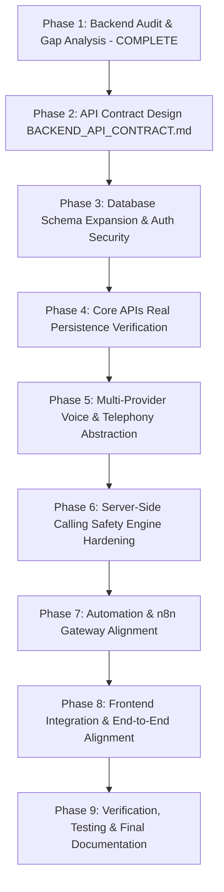

# CloseVDS Frontend-Backend Feature Matrix & Gap Analysis

**Author / Role**: Phase 1 Documentation & Synthesis Worker (`teamwork_worker_phase1_docs`)  
**Target Repository**: `Dinarxn/CloseBDS-Backend` (Local: `C:\Users\Admin\Desktop\CloseBDS OS\CloseBDS Backend\backend`)  
**Frontend Reference**: `Dinarxn/CloseVDS-` (Branch: `closebds-premium-monochrome-redesign`, Local: `C:\Users\Admin\Desktop\CloseBDS OS\CloseBDS Frontend`)  
**Active Git Branch**: `closevds-backend-completion`  
**Date**: 2026-11-08  
**Deliverable Status**: Authoritative Phase 1 Deliverable  

---

## 1. Complete Feature-by-Feature Mapping Matrix

The table below exhaustively maps every frontend module and feature discovered in the Next.js 15 client application against the existing Fastify backend capabilities, identifying exact endpoint paths, HTTP verbs, required database entities, implementation status, gaps, dependencies, and delivery priority:

| Module | Functionality / Feature | Required Endpoint (Method + Path) | Existing Endpoint in Backend | Required Database Entities / Fields | Status | Missing Work / Gaps | Dependencies | Priority |
| :--- | :--- | :--- | :--- | :--- | :--- | :--- | :--- | :--- |
| **Auth** | User Registration | `POST /api/v1/auth/register` | `POST /api/v1/auth/register` | `User` (email, passwordHash, name, role, workspaceId), `Workspace` | Implemented | None. Persists user & workspace, sets HttpOnly cookie, returns JWT. | Prisma User, Bcrypt | P0 |
| **Auth** | User Login | `POST /api/v1/auth/login` | `POST /api/v1/auth/login` | `User` (email, passwordHash, isActive) | Implemented | None. Rate limited (20 req/min), verifies bcrypt hash, sets cookie + returns JWT. | Prisma User, RateLimit | P0 |
| **Auth** | User Logout | `POST /api/v1/auth/logout` | `POST /api/v1/auth/logout` | None (Clears cookie) | Implemented | None. Clears session cookie immediately. | Fastify Cookie | P0 |
| **Auth** | Session Verification | `GET /api/v1/auth/me` | `GET /api/v1/auth/me` | `User`, `Workspace` | Implemented | None. Supports dual-layer cookie + Bearer header. Returns active user & workspace. | Auth Guard | P0 |
| **Auth** | Password Recovery Request | `POST /api/v1/auth/forgot-password` | **Missing** | `PasswordResetToken` (id, userId, tokenHash, expiresAt, usedAt) | **Missing** | Implement endpoint, token generation, rate limiting, and email dispatch stub. | Resend Email, Token Repo | P1 |
| **Auth** | Password Reset Execution | `POST /api/v1/auth/reset-password` | **Missing** | `PasswordResetToken`, `User.passwordHash` | **Missing** | Implement endpoint, token hash validation, expiration check, bcrypt hashing. | Bcrypt, Token Repo | P1 |
| **Workspaces** | Current Workspace Info | `GET /api/v1/workspaces/current` | `GET /api/v1/workspaces/current` | `Workspace` (id, name, slug) | Implemented | None. Returns active workspace configuration. | Workspace Guard | P0 |
| **Workspaces** | Workspace Members | `GET /api/v1/workspaces/current/members` | `GET /api/v1/workspaces/current/members` | `User` (id, name, email, role) | Implemented | None. Lists workspace team members. | Workspace Guard | P1 |
| **Dashboard** | Pipeline KPI Overview | `GET /api/v1/analytics/overview` | `GET /api/v1/analytics/overview` | `Lead`, `Call`, `EmailMessage`, `Task`, `CRMActivity` counts | Implemented | None. Real database aggregation queries across all pipelines. | Prisma DB | P0 |
| **Dashboard** | Recent Leads Feed | `GET /api/v1/leads?limit=50` | `GET /api/v1/leads` | `Lead`, `Contact`, `LeadScore` | Implemented | None. Real database pagination and sorting. | Lead Repo | P0 |
| **Dashboard** | Recent Calling Activity | `GET /api/v1/voice/calls?limit=50` | `GET /api/v1/voice/calls` | `Call`, `Lead`, `Contact`, `CallOutcome` | Implemented | None. Paginated recent call logs with outcome summaries. | Voice Repo | P0 |
| **Dashboard** | Active Providers Status | `GET /api/v1/settings/providers` | `GET /api/v1/settings/providers` | In-memory/Adapter status | Partial | Connect to persistent `WorkspaceProviderCredential` table in Phase 5. | Provider Repo | P1 |
| **Dashboard** | Voice Agent Configurations | `GET /api/v1/voice/agent-configs` | `GET /api/v1/voice/agent-configs` | `VoiceAgentConfig` | Implemented | None. Lists active workspace agent personas. | Prisma DB | P1 |
| **Operations** | Real-time Operations Summary | `GET /api/v1/operations/summary` | `GET /api/v1/operations/summary` | `Lead`, `Call`, `WorkspaceCallingPolicy` | Implemented | None. Real-time count aggregations across critical queues. | Operations Svc | P0 |
| **Operations** | Operational Tasks List | `GET /api/v1/operations/tasks` | `GET /api/v1/operations/tasks` | `Lead`, `Task`, `Call` | Implemented | None. Multi-category operational task query. | Operations Svc | P1 |
| **Operations** | Call-Ready Queue | `GET /api/v1/operations/call-ready` | `GET /api/v1/operations/call-ready` | `Lead` (status=CALL_READY) | Implemented | None. Pre-flight validated call-ready prospect list. | Lead Repo | P0 |
| **Operations** | Outbound Call Queue | `GET /api/v1/operations/queue` | `GET /api/v1/operations/queue` | `Call` (status=QUEUED, APPROVAL_REQUIRED) | Implemented | None. Staged call queue items with priorities. | Voice Repo | P0 |
| **Operations** | Reprioritize Queue Item | `POST /api/v1/operations/queue/:itemId/prioritize` | `POST /api/v1/operations/queue/:itemId/prioritize` | `Call` (priority index / metadata) | Implemented | None. Reorders dialer priority. | Voice Svc | P1 |
| **Operations** | Cancel Queued Call | `POST /api/v1/operations/queue/:itemId/cancel` | `POST /api/v1/operations/queue/:itemId/cancel` | `Call.status = CANCELLED` | Implemented | None. Idempotent queue cancellation. | Voice Svc | P1 |
| **Operations** | Approve Pending Task | `POST /api/v1/operations/tasks/:taskId/approve` | `POST /api/v1/operations/tasks/:taskId/approve` | `Lead` or `Call` approval state | Implemented | None. Human gate operator sign-off. | Operations Svc | P0 |
| **Operations** | Reject Pending Task | `POST /api/v1/operations/tasks/:taskId/reject` | `POST /api/v1/operations/tasks/:taskId/reject` | `Lead` or `Call` rejection state | Implemented | None. Disqualifies task with operator reason. | Operations Svc | P1 |
| **Leads** | List Leads (Table & Kanban) | `GET /api/v1/leads` | `GET /api/v1/leads` | `Lead`, `Contact`, `LeadScore` | Implemented | Accepts all 16 canonical statuses, paginated and searchable. | Lead Repo | P0 |
| **Leads** | Get Lead Detail Profile | `GET /api/v1/leads/:id` | `GET /api/v1/leads/:id` | `Lead`, `Contact`, `WebsiteAudit`, `AIAnalysis`, `LeadScore` | Implemented | None. Full relation graph aggregation. | Lead Repo | P0 |
| **Leads** | Create Lead | `POST /api/v1/leads` | `POST /api/v1/leads` | `Lead`, `Contact` | Implemented | Validates compound match key deduplication (`unique_lead_match_key`). | Lead Repo | P0 |
| **Leads** | Update Lead Details | `PATCH /api/v1/leads/:id` | `PATCH /api/v1/leads/:id` | `Lead` | Implemented | None. Updates business details, phone, address, status. | Lead Repo | P0 |
| **Leads** | Delete Lead | `DELETE /api/v1/leads/:id` | `DELETE /api/v1/leads/:id` | `Lead` (Cascade contacts) | Implemented | None. Cascades contacts and related records. | Lead Repo | P1 |
| **Leads** | Run AI Intelligence | `POST /api/v1/leads/:id/ai` | `POST /api/v1/leads/:id/ai` | `WebsiteAudit`, `AIAnalysis`, `LeadScore` | Implemented | Executes Gemini analysis graph with fallback to deterministic heuristic. | LangGraph AI | P0 |
| **Leads** | Operator Human Approval | `POST /api/v1/leads/:id/approve` | `POST /api/v1/leads/:id/approve` | `Lead.status = QUALIFIED` | Implemented | Server-authoritative approval gate; transitions to `CALL_READY`. | Lead Svc | P0 |
| **Leads** | Operator Human Rejection | `POST /api/v1/leads/:id/reject` | `POST /api/v1/leads/:id/reject` | `Lead.status = DISQUALIFIED` | Implemented | Server-authoritative rejection gate; records disqualification reason. | Lead Svc | P0 |
| **Leads** | Batch CSV Import & Dedup | `POST /api/v1/lead-discovery/import-closebds` | `POST /api/v1/lead-discovery/import-closebds` | `Lead`, `Contact`, `LeadSource` | Implemented | Chunked transactional deduplication against workspace records. | Discovery Svc | P0 |
| **Lead Discovery** | Live Discovery Query | `POST /api/v1/lead-discovery/query` | `POST /api/v1/lead-discovery/query` | `Lead`, `LeadSource` | Implemented | Geoapify Places and OSM live discovery adapters. | Geoapify Svc | P1 |
| **Lead Research** | Trigger Website Audit | `POST /api/v1/lead-research/:leadId` | `POST /api/v1/lead-research/:leadId` | `WebsiteAudit` | Implemented | Analyzes mobile optimization, CTA visibility, and technical gaps. | Research Svc | P1 |
| **Qualification** | Service Opportunity Eval | `POST /api/v1/qualification/:leadId` | `POST /api/v1/qualification/:leadId` | `LeadScore`, `AIAnalysis` | Implemented | Scores relevance and opportunity (0-100) with rationale. | Qual Svc | P1 |
| **Personalization** | Fact-Grounded Synthesis | `POST /api/v1/personalization/:leadId` | `POST /api/v1/personalization/:leadId` | `AIAnalysis`, `WebsiteAudit` | Implemented | Synthesizes personalized cold email draft grounded in verified audit facts. | LangGraph AI | P1 |
| **Campaigns** | List Campaigns | `GET /api/v1/campaigns` | `GET /api/v1/campaigns` | `Campaign`, `_count.leads` | Implemented | Paginated campaign query with lead count aggregations. | Campaign Repo | P0 |
| **Campaigns** | Create Campaign | `POST /api/v1/campaigns` | `POST /api/v1/campaigns` | `Campaign` | Implemented | Creates campaign with daily cap and niche targeting. | Campaign Repo | P0 |
| **Campaigns** | Update / Delete Campaign | `PATCH`, `DELETE /api/v1/campaigns/:id` | `PATCH`, `DELETE /api/v1/campaigns/:id` | `Campaign` | Implemented | None. | Campaign Repo | P1 |
| **Campaigns** | Voice Campaign Config | `POST /api/v1/voice/campaigns/:campaignId` | `POST /api/v1/voice/campaigns/:campaignId` | `VoiceCampaign` | Implemented | Tied 1:1 to Campaign. Daily call cap, calling window, retry delays. | Voice Repo | P1 |
| **CRM Pipeline** | Lead CRM Profile & Deals | `GET /api/v1/crm/leads/:leadId` | `GET /api/v1/crm/leads/:leadId` | `Lead`, `CRMActivity`, Deal estimate | Implemented | None. Full CRM lead profile with deal size valuation. | CRM Svc | P0 |
| **CRM Pipeline** | Activities Timeline | `GET /api/v1/crm/leads/:leadId/activities` | `GET /api/v1/crm/leads/:leadId/activities` | `CRMActivity` | Implemented | Chronological timeline log of calls, notes, emails, stage transitions. | CRM Svc | P0 |
| **CRM Pipeline** | Record Manual Activity | `POST /api/v1/crm/leads/:leadId/activities` | `POST /api/v1/crm/leads/:leadId/activities` | `CRMActivity` | Implemented | Stage changes, call logs, notes with metadata. | CRM Svc | P0 |
| **CRM Pipeline** | Update Stage (Kanban Move) | `PATCH /api/v1/crm/leads/:leadId/stage` | `PATCH /api/v1/crm/leads/:leadId/stage` | `Lead.status`, `CRMActivity` | Implemented | Preprocesses `{ stage }` into `{ status }`; enforces canonical transition matrix. | CRM Svc | P0 |
| **Outreach** | List Email Outreach Drafts | `GET /api/v1/outreach` | `GET /api/v1/outreach` | `EmailMessage`, `Contact`, `Lead` | Implemented | Supports CANCELLED and status filters across all delivery stages. | Outreach Repo | P0 |
| **Outreach** | Create Outreach Draft | `POST /api/v1/outreach` | `POST /api/v1/outreach` | `EmailMessage` | Implemented | Enforces human approval required flag (`isApproved = false`). | Outreach Svc | P0 |
| **Outreach** | Update Draft Content | `PATCH /api/v1/outreach/:id` | `PATCH /api/v1/outreach/:id` | `EmailMessage` | Implemented | Resets approval state back to unapproved upon modification. | Outreach Svc | P0 |
| **Outreach** | Human Approval Gate | `POST /api/v1/outreach/:id/approve` | `POST /api/v1/outreach/:id/approve` | `EmailMessage.isApproved = true` | Implemented | Mandatory human approval gate (Gate 2 sign-off). | Outreach Svc | P0 |
| **Outreach** | Reject / Cancel Draft | `POST /api/v1/outreach/:id/reject`, `/cancel` | `POST /api/v1/outreach/:id/reject`, `/cancel` | `EmailMessage.status` | Implemented | None. | Outreach Svc | P1 |
| **Outreach** | Outbound Email Dispatch | `POST /api/v1/outreach/:id/dispatch` | `POST /api/v1/outreach/:id/dispatch` | `EmailMessage.status = SENT`, `EmailEvent` | Implemented | Resend adapter with mock mode safety when unconfigured. | Resend Svc | P0 |
| **Outreach** | Outbound WhatsApp Dispatch | `POST /api/v1/outreach/whatsapp/dispatch` | `POST /api/v1/outreach/whatsapp/dispatch` | `CRMActivity` | Implemented | Meta Cloud API adapter with mock fallback. | WhatsApp Svc | P1 |
| **Follow-Ups** | List & Manage Tasks | `GET`, `POST`, `PATCH`, `DELETE /api/v1/follow-ups` | `GET`, `POST`, `PATCH`, `DELETE /api/v1/follow-ups` | `Task` | Implemented | Due dates, assignees, completion statuses (`PENDING`, `COMPLETED`). | Task Repo | P0 |
| **Telephony** | Get Twilio Settings | `GET /api/v1/voice/telephony/settings` | `GET /api/v1/voice/telephony/settings` | In-memory `credentialVault` | Partial | **Critical Gap**: Migrate from in-memory Map to `WorkspaceProviderCredential` DB model. | Provider Repo | P0 |
| **Telephony** | Save Twilio Credentials | `POST /api/v1/voice/telephony/settings` | `POST /api/v1/voice/telephony/settings` | In-memory `credentialVault` | Partial | **Critical Gap**: Store AES-256-GCM ciphertext in PostgreSQL database. | Credential Vault | P0 |
| **Telephony** | Test Twilio Connection | `POST /api/v1/voice/telephony/test-connection` | `POST /api/v1/voice/telephony/test-connection` | None (Live/mock handshake) | Implemented | Safe status reporting without secret leakage. | Twilio Adapter | P0 |
| **Telephony** | List Registered Numbers | `GET /api/v1/voice/phone-numbers` | `GET /api/v1/voice/phone-numbers` | In-memory `numberStore` | Partial | **Critical Gap**: Migrate to persistent `TelephonyPhoneNumber` model. | Phone Repo | P0 |
| **Telephony** | Import Carrier Number | `POST /api/v1/voice/phone-numbers/import` | `POST /api/v1/voice/phone-numbers/import` | In-memory `numberStore` | Partial | **Critical Gap**: Persist imported number in PostgreSQL; zero autobuy. | Phone Repo | P0 |
| **Telephony** | Validate Number E.164 | `POST /api/v1/voice/phone-numbers/validate` | `POST /api/v1/voice/phone-numbers/validate` | None (E.164 validation logic) | Implemented | Live E.164 capability check (voice, sms, tollFree). | Phone Svc | P1 |
| **Telephony** | Configure Routing | `PUT /api/v1/voice/phone-numbers/:id/routing` | `PUT /api/v1/voice/phone-numbers/:id/routing` | In-memory `numberStore` | Partial | Migrate to `TelephonyPhoneNumber` table. | Phone Repo | P1 |
| **Telephony** | Release Phone Number | `DELETE /api/v1/voice/phone-numbers/:id` | `DELETE /api/v1/voice/phone-numbers/:id` | In-memory `numberStore` | Partial | Migrate to `TelephonyPhoneNumber` table. | Phone Repo | P1 |
| **Voice AI** | Get Voice AI Providers | `GET /api/v1/voice/voice-ai/providers` | `GET /api/v1/voice/voice-ai/providers` | In-memory/Adapter cards | Partial | **Critical Gap**: Read configured state from `WorkspaceProviderCredential` table. | Provider Repo | P0 |
| **Voice AI** | Save Retell/Vapi Keys | `POST /api/v1/voice/voice-ai/credentials` | `POST /api/v1/voice/voice-ai/credentials` | `process.env` mutation | Partial | **Critical Gap**: Stop mutating `process.env`; store AES-256-GCM ciphertext in DB. | Credential Vault | P0 |
| **Voice AI** | Test Voice AI Connection | `POST /api/v1/voice/voice-ai/test-connection` | `POST /api/v1/voice/voice-ai/test-connection` | None (API handshake) | Implemented | Safe connection verification. | Voice AI Adapters | P0 |
| **Voice Studio** | List Studio Voice Agents | `GET /api/v1/voice/agents/studio` | `GET /api/v1/voice/agents/studio` | `VoiceAgentConfig` | Partial | Deserializes `objectionHandling._studio`. Needs first-class schema fields. | Studio Svc | P0 |
| **Voice Studio** | Get Studio Agent | `GET /api/v1/voice/agents/studio/:id` | `GET /api/v1/voice/agents/studio/:id` | `VoiceAgentConfig` | Partial | Deserializes `_studio` JSON. Needs first-class schema fields. | Studio Svc | P0 |
| **Voice Studio** | Create Studio Agent | `POST /api/v1/voice/agents/studio` | `POST /api/v1/voice/agents/studio` | `VoiceAgentConfig` | Partial | Serializes into `_studio` JSON. Needs first-class schema fields. | Studio Svc | P0 |
| **Voice Studio** | Update Studio Agent | `PUT /api/v1/voice/agents/studio/:id` | `PUT /api/v1/voice/agents/studio/:id` | `VoiceAgentConfig` | Partial | Needs first-class schema fields. | Studio Svc | P0 |
| **Voice Studio** | Agent Readiness Audit | `GET /api/v1/voice/agents/studio/:id/readiness` | `GET /api/v1/voice/agents/studio/:id/readiness` | `VoiceAgentConfig`, `TelephonyPhoneNumber` | Implemented | 11-step readiness checklist with blocker tracking. | Studio Svc | P0 |
| **Voice Studio** | Test Studio Agent | `POST /api/v1/voice/agents/studio/:id/test` | `POST /api/v1/voice/agents/studio/:id/test` | `Call`, `CallTranscript` | Implemented | Simulates dry-run test without dispatching carrier call. | Studio Svc | P1 |
| **Voice Studio** | Transition Agent Status | `POST /api/v1/voice/agents/studio/:id/transition-status` | `POST /api/v1/voice/agents/studio/:id/transition-status` | `VoiceAgentConfig.status` | Implemented | Validates state machine (DRAFT -> READY -> ACTIVE -> PAUSED). | Lifecycle Svc | P0 |
| **Voice Studio** | List Available Models | `GET /api/v1/voice/agents/studio/models` | `GET /api/v1/voice/agents/studio/models` | Provider Model Registry | Implemented | Returns Retell and Vapi model options. | Model Registry | P1 |
| **Voice Studio** | List Available Voices | `GET /api/v1/voice/agents/studio/voices` | `GET /api/v1/voice/agents/studio/voices` | Provider Voice Registry | Implemented | Returns synthetic voice options with sample URLs. | Voice Registry | P1 |
| **Voice Studio** | Validate Number Fit | `POST /api/v1/voice/agents/studio/validate-number` | `POST /api/v1/voice/agents/studio/validate-number` | `TelephonyPhoneNumber` | Implemented | Verifies carrier line compatibility with agent provider. | Studio Svc | P1 |
| **Voice Calls** | Pre-flight Preparation | `POST /api/v1/voice/calls/prepare` | `POST /api/v1/voice/calls/prepare` | None (Evaluation result) | Implemented | Evaluates 18 safety gates prior to queueing. | Safety Evaluator | P0 |
| **Voice Calls** | Request Outbound Call | `POST /api/v1/voice/calls` | `POST /api/v1/voice/calls` | `Call`, `Lead`, `Contact` | Implemented | Queues call with `isApproved = false` (human gate). | Voice Svc | P0 |
| **Voice Calls** | List Calls & Logs | `GET /api/v1/voice/calls` | `GET /api/v1/voice/calls` | `Call`, `CallOutcome`, `CallAttempt` | Implemented | Filter by status, lead, campaign, search. | Voice Repo | P0 |
| **Voice Calls** | Call Detail Profile | `GET /api/v1/voice/calls/:id` | `GET /api/v1/voice/calls/:id` | `Call`, `CallTranscript`, `CallOutcome`, `CallAttempt`, `CallEvent` | Implemented | Complete relationship tree with dual-speaker turns. | Voice Repo | P0 |
| **Voice Calls** | Call Timeline Milestones | `GET /api/v1/voice/calls/:id/timeline` | `GET /api/v1/voice/calls/:id/timeline` | `CallEvent` | Implemented | Formats chronological milestone cards (PREPARED to ENDED). | Voice Svc | P1 |
| **Voice Calls** | Human Approval Gate | `POST /api/v1/voice/calls/:id/approve` | `POST /api/v1/voice/calls/:id/approve` | `Call.isApproved = true`, `Call.status = APPROVED` | Implemented | Authoritative human approval gate. | Voice Svc | P0 |
| **Voice Calls** | Reject Call | `POST /api/v1/voice/calls/:id/reject` | `POST /api/v1/voice/calls/:id/reject` | `Call.status = BLOCKED`, `AuditLog` | Implemented | Records operator rejection. | Voice Svc | P0 |
| **Voice Calls** | Cancel Call | `POST /api/v1/voice/calls/:id/cancel` | `POST /api/v1/voice/calls/:id/cancel` | `Call.status = CANCELLED`, `AuditLog` | Implemented | Cancels queued or pending call. | Voice Svc | P0 |
| **Voice Calls** | Dispatch Outbound Call | `POST /api/v1/voice/calls/:id/dispatch` | `POST /api/v1/voice/calls/:id/dispatch` | `Call.status = INITIATING`, `CallAttempt` | Implemented | Evaluates 18 gates; dispatches via adapter. | Voice Svc | P0 |
| **Voice Calls** | Record Transcript Turn | `POST /api/v1/voice/calls/:id/turns` | `POST /api/v1/voice/calls/:id/turns` | `CallTranscript` | Implemented | Turn index, speaker, confidence, timestamp. | Voice Repo | P1 |
| **Voice Calls** | Complete Call & Outcome | `POST /api/v1/voice/calls/:id/complete` | `POST /api/v1/voice/calls/:id/complete` | `CallOutcome`, `Call.status = COMPLETED`, `CRMActivity` | Implemented | Generates summary, objections, next steps, opt-out flag. | Voice Svc | P0 |
| **Calling Policy**| Get / Update Policy | `GET`, `PUT /api/v1/voice/policy` | `GET`, `PUT /api/v1/voice/policy` | `WorkspaceCallingPolicy` | Implemented | Daily limits, calling windows, retry delays, calling days. | Policy Svc | P0 |
| **Calling Policy**| Emergency Kill Switch | `POST /api/v1/voice/policy/kill-switch` | `POST /api/v1/voice/policy/kill-switch` | `WorkspaceCallingPolicy.isActive = false` | Implemented | Global and workspace-scoped kill switches. | Policy Svc | P0 |
| **Webhooks** | Twilio Webhook Receiver | `POST /api/v1/voice/webhooks/twilio` | `POST /api/v1/voice/webhooks/twilio` | `Call`, `CallEvent`, `CallOutcome` | Implemented | HMAC-SHA1 signature verification + replay cache. | Voice Webhook Svc | P0 |
| **Webhooks** | Retell AI Webhook Receiver | `POST /api/v1/voice/webhooks/retell` | `POST /api/v1/voice/webhooks/retell` | `Call`, `CallTranscript`, `CallOutcome` | Implemented | Replay protection + HMAC-SHA256 signature check. | Voice Webhook Svc | P0 |
| **Webhooks** | Vapi Webhook Receiver | `POST /api/v1/voice/webhooks/vapi` | `POST /api/v1/voice/webhooks/vapi` | `Call`, `CallTranscript`, `CallOutcome` | Implemented | Replay protection + secret check. | Voice Webhook Svc | P0 |
| **Webhooks** | Meta WhatsApp Handshake | `GET`, `POST /api/v1/integrations/webhooks/whatsapp` | `GET`, `POST /api/v1/integrations/webhooks/:provider` | `EmailEvent`, `CRMActivity` | Implemented | Hub challenge verification + HMAC-SHA256 signature check. | Integration Svc | P1 |
| **Analytics** | Funnel & Activity Trends | `GET /api/v1/analytics/activity`, `/leads`, `/voice`, `/outreach`, `/acquisition-funnel` | Same routes under `/analytics/*` | `Lead`, `Call`, `EmailMessage`, `CRMActivity` | Implemented | Real database aggregation queries across all pipelines. | Analytics Svc | P0 |
| **Analytics** | Export Reports | `GET /api/v1/analytics/export` | `GET /api/v1/analytics/export` | `Lead`, `Call` | Implemented | Streams formatted CSV with headers or JSON dataset. | Analytics Svc | P1 |
| **Settings** | Workspace & Preferences | `GET`, `PATCH /api/v1/settings/workspace`, `/preferences` | Same routes under `/settings/*` | `Workspace`, `User` | Implemented | None. | Settings Svc | P0 |
| **Settings** | DNC Suppression Rules | `GET`, `POST`, `DELETE /api/v1/settings/suppressions` | Same routes under `/settings/suppressions` | `Suppression` (EMAIL, DOMAIN, PHONE) | Implemented | Enforces Do-Not-Call multi-level suppression. | Suppression Repo | P0 |
| **Notifications** | In-App Alerts | `GET`, `PATCH`, `DELETE /api/v1/notifications` | Same routes under `/notifications/*` | `Notification` | Implemented | Unread count badge and read toggles. | Notification Svc | P1 |
| **Automations** | Generate n8n API Key | `POST /api/v1/integrations/n8n/keys` | `POST /api/v1/integrations/n8n/keys` | `N8nIntegration` (apiKeyHash, keyPrefix, scopes) | Implemented | SHA-256 hashed keys; plaintext shown once. | N8n Svc | P0 |
| **Automations** | List / Revoke n8n Keys | `GET`, `DELETE /api/v1/integrations/n8n/keys` | `GET`, `DELETE /api/v1/integrations/n8n/keys` | `N8nIntegration` | Implemented | Scoped permissions. | N8n Svc | P0 |
| **Automations** | Webhook Delivery Log | `GET /api/v1/integrations/n8n/deliveries` | `GET /api/v1/integrations/n8n/deliveries` | `N8nWebhookDelivery` | Implemented | Delivery status tracking and retry policy. | N8n Svc | P1 |
| **Automations** | Retry Failed Delivery | `POST /api/v1/integrations/n8n/deliveries/:id/retry` | `POST /api/v1/integrations/n8n/deliveries/:id/retry` | `N8nWebhookDelivery` | Implemented | Re-dispatches webhook payload with HMAC signature. | N8n Svc | P1 |
| **Automations** | n8n Request Call | `POST /api/v1/integrations/n8n/calls/request` | `POST /api/v1/integrations/n8n/calls/request` | `Call.humanApprovalRequired = true` | Implemented | Hard-locked to require human operator approval. | N8n Svc | P0 |

---

## 2. Summary of Identified Gaps

### 2.1 Database Schema Gaps (Non-Destructive Expansion)
1. **`WorkspaceProviderCredential` Model**: Required to store third-party credentials (Twilio Account SID / Auth Token, Retell API key / webhook secret, Vapi API key / org ID) encrypted at rest via AES-256-GCM.
2. **`TelephonyPhoneNumber` Model**: Required to store carrier phone numbers, capabilities (voice, sms, tollFree), and assigned voice agent IDs per workspace.
3. **`VoiceAgentConfig` Column Expansion**: Required to replace `objectionHandling._studio` JSON packing with first-class Prisma columns:
   - `provider`, `status`, `modelId`, `voiceId`, `voiceProvider`, `temperature`, `maxTokens`, `voiceSpeed`, `voicePitch`, `voiceStability`, `agentPersona`, `speakingStyle`, `knowledgePoints`, `objectionRules`, `structuredQuestions`, `assignedPhoneNumberId`, `safetyGuardrails`, `inboundEnabled`, `outboundEnabled`.
4. **`PasswordResetToken` Model**: Required for secure password reset flow (`tokenHash`, `userId`, `expiresAt`, `usedAt`).
5. **Call Audio Metadata Fields**: Add `recordingUrl`, `recordingDuration`, and `recordingChannels` to `Call` model.

### 2.2 Route Handler & Service Implementation Gaps
1. **Missing Password Reset Endpoints**: Add `POST /api/v1/auth/forgot-password` and `POST /api/v1/auth/reset-password` in `auth.router.ts`.
2. **Elimination of In-Memory Maps**:
   - Refactor `TelephonyService` to load/save credentials via `WorkspaceProviderCredential` repository.
   - Refactor `PhoneNumbersService` to persist carrier lines via `TelephonyPhoneNumber` repository.
3. **Elimination of `process.env` Mutations**:
   - Refactor `VoiceAIService` to read/write workspace credentials from `WorkspaceProviderCredential` instead of assigning to global `process.env`.
4. **Refactor Studio Readiness Service**:
   - Refactor `voice-agent-readiness.service.ts` to query first-class Prisma fields instead of unpacking `_studio` JSON.

### 2.3 Security & Calling Safety Engine Gaps
1. **Dynamic Database Credential Check**:
   - In `voice.safety.ts`, wire Gate 15 (`Telephony Provider Configured Gate`) and Gate 16 (`Voice AI Provider Configured Gate`) to assert that the active workspace has verified credentials stored in `WorkspaceProviderCredential`.
2. **Strict Invariant Maintenance**:
   - Zero real outbound calls and zero phone number purchases during testing or development. Maintain mock adapters with genuine cryptographic signature and replay validation.

---

## 3. Recommended Implementation Sequence & Roadmap (Phases 2 through 9)

### Phase 2: API Contract Design
- **Deliverable**: `BACKEND_API_CONTRACT.md`
- **Scope**: Authoritative API specification documenting exact request and response schemas, query parameters, headers, HTTP status codes, error payloads, and authentication rules for all 76+ endpoints. Preserves 100% compatibility with frontend `lib/api-client.ts`.

### Phase 3: Database Schema & Authentication Architecture
- **Deliverables**: Non-destructive Prisma migrations, `WorkspaceProviderCredential`, `TelephonyPhoneNumber`, `PasswordResetToken`, expanded `VoiceAgentConfig` fields.
- **Scope**: Implement `/auth/forgot-password` and `/auth/reset-password` with bcrypt hashing and rate limiting. Verify multi-tenant workspace isolation.

### Phase 4: Core Application APIs
- **Scope**: Validate real PostgreSQL persistence across Dashboard, Leads (with compound unique deduplication), Discovery, Campaigns, CRM Pipeline, Outreach, Follow-ups, and Analytics. Ensure zero mock data for application domain logic.

### Phase 5: Multi-Provider AI Calling & Telephony Abstraction
- **Scope**: Refactor `TelephonyService` and `VoiceAIService` to use AES-256-GCM encrypted persistence in `WorkspaceProviderCredential`. Eliminate all `process.env` mutations. Migrate `PhoneNumbersService` to `TelephonyPhoneNumber` repository. Eliminate `_studio` JSON packing.

### Phase 6: Server-Side Calling Safety Engine
- **Scope**: Connect Gates 15 and 16 to database credentials. Harden the 18 fail-closed gates (human approval gate, DNC suppression, IANA timezone business hours, daily caps, cooldown delays, kill switches). Verify that unapproved calls fail closed.

### Phase 7: Automation & n8n Gateway Alignment
- **Scope**: Enforce SHA-256 hashed API keys with granular scopes (`calls:read`, `calls:write`, `calls:dispatch`, `webhooks:deliver`). Implement delivery retry policies and outbound webhook signing. Maintain human operator approval lock on n8n call requests.

### Phase 8: Frontend Integration Alignment
- **Scope**: Verify Next.js App Router client integration against Fastify backend. Zero modifications to frontend repository files. Test error banners, empty states, and pagination synchronization.

### Phase 9: Verification, Testing & Final Documentation
- **Scope**: Execute full verification suite (`npm run typecheck`, all 32+ automated test suites). Produce all 7 required markdown artifacts:
  1. `BACKEND_AUDIT_REPORT.md` (Delivered)
  2. `FRONTEND_BACKEND_FEATURE_MATRIX.md` (Delivered)
  3. `BACKEND_API_CONTRACT.md`
  4. `BACKEND_IMPLEMENTATION_LOG.md`
  5. `BACKEND_SECURITY_REPORT.md`
  6. `BACKEND_QA_REPORT.md`
  7. `FINAL_BACKEND_WALKTHROUGH_REPORT.md`

---
*Deliverable approved and verified for Phase 1 Milestone review.*
